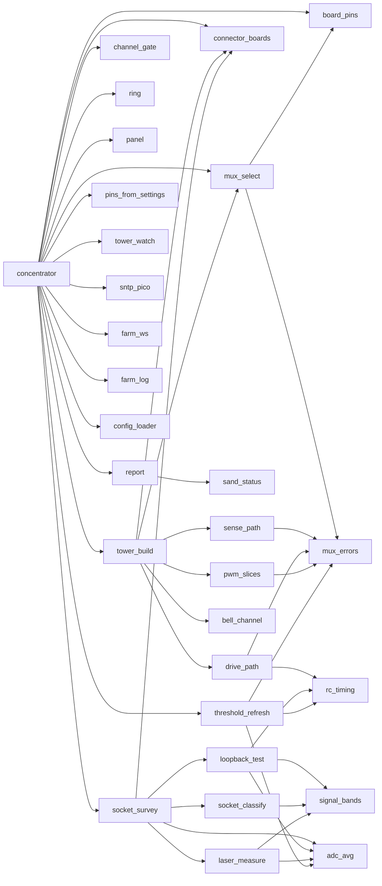

# sandswing_next: structure

concentrator.py is the root. It builds every object and injects it into the modules that use it. Leaf modules never import each other's internals. Each part reports through a plain `status()` dict, `report.py` assembles the payload, and only concentrator.py talks to `farm_ws`.

## Flow
1. **Startup tests:**
   - `tower_build.build_from_pins`: PWM slice check before any claim, then one Tower owns A/B/C, plus GP26, GP21 @ `threshold_mux.pwm_hz` and GP28.
   - Lasers and sense inputs are claimed once.
   - `socket_survey.survey_all` updates `channel_gate`.
   - The loopback self-test runs.
   - `sntp_pico` starts if there is Wi-Fi and `time.ntp_ips` is set.
2. **Settle, then ring:** `ring.Ring.start(kinds)` holds the heads' lasers on and sends MIDI on trips.
3. **Every loop:** `poll_sense`, then `ring.poll`, `panel_frame` (strip + payload), `tower.poll`, `sntp.set_ringing`, `gate.enforce`.
4. **On going inactive:** rescan (survey again, then settle and ring again).

## Modules (lines / .mpy bytes from mpy-cross 1.29, mpy v6.3)
| Module | Purpose | Lines | .mpy B |
|---|---|---|---|
| concentrator.py | root: build, wire, run | 427 | 6534 |
| mux_select.py | Tower (sole A/B/C owner), select/aselect, registry get_tower/get_address/get_analog | 219 | 2674 |
| tower_build.py | settings pins -> (Tower, [Bell]); idempotent | 93 | 2025 |
| sense_path.py | SensePath (GP26 via inward 4051) | 16 | 295 |
| drive_path.py | DrivePath (GP21 -> RC -> outward 4051, GP28 readback) | 98 | 1428 |
| bell_channel.py | Bell (one Y; refs to paths, laser, sense pin) | 26 | 361 |
| mux_errors.py | the shared exceptions | 22 | 255 |
| board_pins.py | GP -> pin objects; release() | 47 | 668 |
| pwm_slices.py | RP2350A slice map + check | 99 | 1351 |
| rc_timing.py | rc2_tau_s, rc_settle_s, refresh_interval_s | 28 | 375 |
| signal_bands.py | scale + pass bands (numbers only) | 14 | 278 |
| adc_avg.py | avg(adc, n) | 8 | 85 |
| laser_measure.py | counts_to_ma, classify_laser, measure_laser | 43 | 630 |
| loopback_test.py | LoopbackSelfTest | 133 | 2538 |
| socket_classify.py | classify_socket (pure; TODO spec C1-C8) | 78 | 1957 |
| socket_survey.py | SocketSurvey + survey_all | 85 | 1658 |
| connector_boards.py | boards, apply_boards | 32 | 522 |
| channel_gate.py | ChannelGate | 38 | 539 |
| threshold_refresh.py | ThresholdRefresher + refresher_from_cfg | 183 | 1971 |
| panel.py | panel_frame (6 LEDs) -> strip / rig / ws; StatusSlot | 75 | 1175 |
| report.py | assembles status payload from parts | 22 | 302 |
| ring.py | Ring (lasers on, rest level, MIDI, strokes) | 128 | 1771 |
| sntp_pico.py | SNTP clock (copied as is) | 506 | 5914 |
| pins_from_settings.py | load_pinmap only | 60 | 734 |
| tower_watch.py, config_loader.py, farm_ws.py, farm_log.py, sand_status.py | repo, unchanged | 237/382/104/138/368 | 2332/3868/1816/986/4144 |
| code.py, boot.py, bell_machine.py | repo, unchanged (bell_machine not wired yet) | 103/15/218 | 1764/276/1577 |

Everything concentrator imports comes to about **49 KB of .mpy**. The old 1,266-line draft alone was 17 KB. RAM cost after import is roughly the .mpy size (bytecode, constants and qstrs stay in RAM). Treat it as an estimate: it was not measured on the board (`gc.mem_free()` before and after the import is the real test).

## Dependencies

`ring.py` imports nothing from the tree. Its standalone `__main__` block lazily imports concentrator to do the setup; that is not a module-level import. `mux_select` imports `board_pins` lazily, only when no pin factory is injected.

## Tests (`python3 tests/run_all.py`)
- 13 `tests/test_<module>.py` files hold the 49 draft tests (`support.py` has the shared fakes and rigs).
- `test_sntp_pico.py` has 19 tests.
- `test_abc_fix.py` has 23 checks: the original repo still fails with "GP18 in use", and the new tree passes.
- `test_imports.py`: every module imports on the fake board modules, and no pin is claimed at import.
- `test_concentrator.py`: Concentrator end to end on the fakes, covering probe, rescan, the ring and a new-head stroke.
- `test_ring.py` tests Ring.
- The repo's `test_machine.py` and `test_strip.py` are included.
