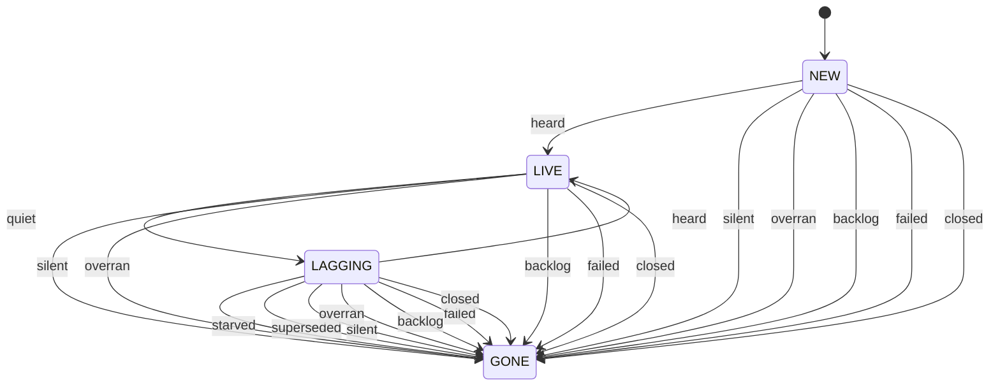
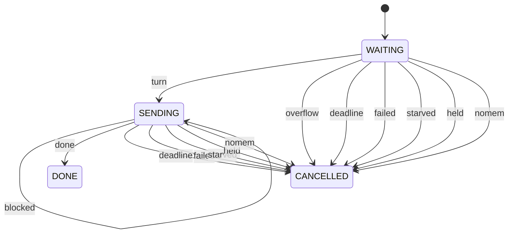
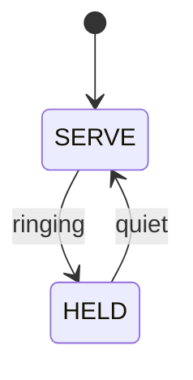
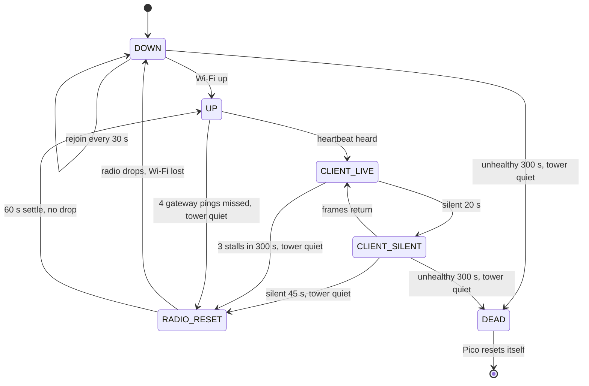
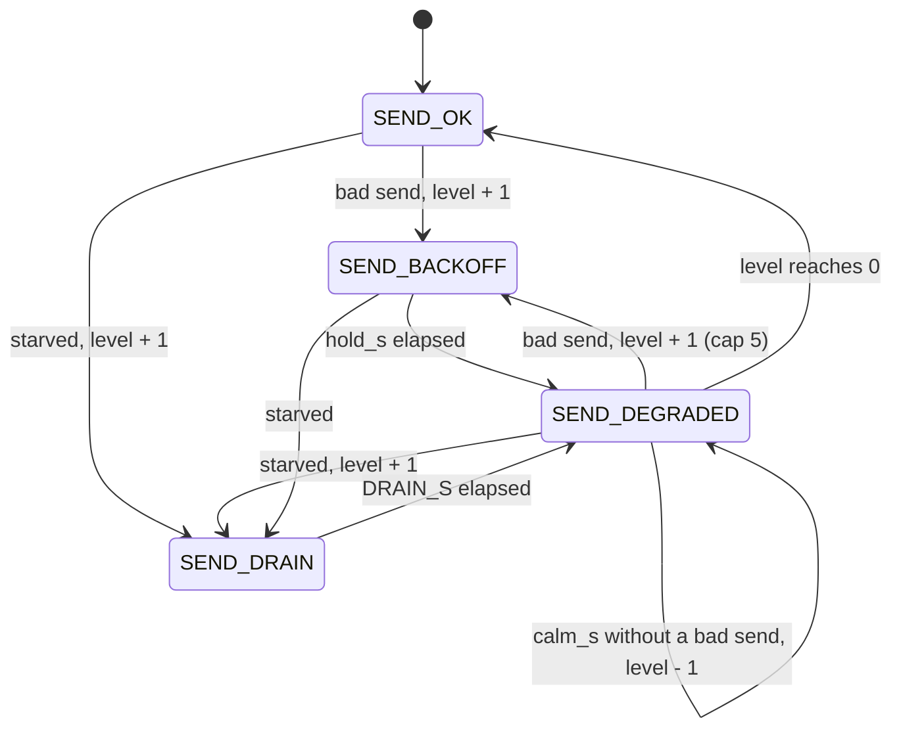

# Link health: concentrator <-> Sandbells

Who connects to whom: the Pico is the **server** (adafruit_httpserver on port
80, `/status` and `/ws`).  Sandbells connects to it twice: the ingest service
(`manage.py ingest_events`, Python websocket-client) and, while page 3 is
open, the kiosk browser (`farm_status.js`).  nginx and gunicorn are not in the
WebSocket path.  Up to `MAX_WS_CLIENTS` (4) clients.

## Wire

| direction | schema | type | when | stored by Sandbells |
|---|---|---|---|---|
| Pico -> all | `sand.event/v1` | `stroke` | each stroke | yes |
| Pico -> all | `sand.event/v1` | `link` | client connected / dropped / refused, wifi_lost, wifi_back, link_dead, reset | yes |
| Pico -> all | `sand.panel/v1` | `heartbeat` | every 5 s (`PICO_HEARTBEAT_S`) | no: page 3 widget only |
| client -> Pico | `sand.hello/v1` | `heartbeat` | every 5 s | (Pico only notes "heard") |

Every frame uses the same envelope: `schema, type, src, id, boot_id, seq,
tick_ms, utc_ms, err_ms, sync, acc, epoch, session, mode, srv, stratum, body`.
`seq` of `link` events is the normal event sequence (Sandbells' gap tracker
sees them); the heartbeat's `seq` is its own counter and `body.last_seq` is
the newest event seq of this boot.

`link` body: `what`, `reason`, `clients`, plus `peer`, `replay`, `level`, `up_s`,
`hb`, `count`, `down_s`, `ip`, `hold_s`, `why`, `refused` as relevant.

Heartbeat body: `panel` (6 x RGB, the ON phase of any blink), `panel_state`,
`link` (LED1 state), `tower`, `net` (`farm_ws.link_status()`: connects,
drops, refused, refused_backoff, replays_done, send_timeouts, silent_drops,
last_drop_reason, last_drop_age_s, clients, live, rx_age_s, send_state,
send_level, wifi_lost, rejoins, radio_resets),
`wifi` (`ip`, `rssi`), `sync`, `time` (`srv`, `stratum`, `last` burst result
with `why`, `peer` = stratum/leap of the last reply even when rejected, so a
sandmon GPS NO Lock shows as stratum 16 / leap 3), `last_seq`, `uptime_s`,
`last_reset`, `watchdog`, `mem_free`.

## Rules (code constants, no settings)

* Pico: a client that has sent a text frame must keep sending; quiet
  `CLIENT_LAG_S` (10 s, two missed 5 s hellos) -> LAGGING: nothing more is
  written to it until it is heard again; silent `CLIENT_SILENT_S` (20 s) ->
  cut.  Clients that never send (old ingest,
  debug listeners) are not timed out.
* Pico: every send has a deadline (`SEND_TIMEOUT_S` 0.4 s).  adafruit_httpserver
  4.8.2 `send_message()` / `close()` retry EAGAIN for ever on a full TCP
  buffer, which froze the whole concentrator on a dead peer.  `ws_bounds.py`
  (boot prints `ws bounds: on`, `request bounds: on`) puts deadlines on the
  library's own waits: reply/handshake send 0.3 s, rest of a frame 0.3 s, one
  HTTP request 0.3 s.  A bound that passes drops that one client.  The numbers
  live in the table at the top of `link_health.py`; `ws_bounds.py` and
  `farm_ws.py` read them from there.
* Pico: one `farm_ws.poll()` is held to `POLL_BUDGET_S` (1.0 s): every phase
  (library request, refusal closes, replay chunk, client reads) stops when the
  budget is spent and carries on the next 50 ms turn.  See "Send path" below.
* Pico: the last `REPLAY_N` (32) events are replayed to a new client, a frame
  per poll turn (more slowly, fewer, or not at all after a slow send: the
  `SendPath` table); Sandbells ignores duplicates (UNIQUE src, boot_id, seq).
  Live events for a client that is still being replayed queue behind the
  replay, so the order stays seq order.
* Pico: LED1 green = a heartbeat client heard within 20 s (before any client
  has sent a heartbeat this boot, any client counts, as before).
* Pico: Wi-Fi supervision every 2 s: lost -> LED1 orange (`no_wifi`), clients
  dropped, rejoin every 30 s (120 s while ringing; a join blocks sensing up to
  10 s per network, watchdog paused), server rebound if the IP changed, SNTP
  started if boot had no Wi-Fi.
* Pico: Wi-Fi "up" but nothing heard for `LINK_DEAD_S` (45 s, tower
  inactive, after a heartbeat client was seen this boot): one radio off/on
  per silent spell.
* Pico: an unhealthy spell (Wi-Fi down, gateway ping failing, or a heartbeat
  client gone silent) is tracked across radio resets and rejoins.  If it lasts
  `PICO_RESET_S` (300 s) with the tower quiet, `microcontroller.reset()`.  This
  does not need the hardware watchdog: a wedged Wi-Fi stack never heals itself
  (it took an mpremote Ctrl-D or a power cycle).  A working gateway ping, a live
  client, or `CALM_S` (90 s) of Wi-Fi up with no bad sign ends the spell, so a
  blip with no client and a router that ignores pings never resets.  At most
  one reset per spell; a rebooted Pico starts a new spell.
* Pico: repeated stalls.  A poll pass that takes `STALL_S` (5 s) or more is a
  stall (the Wi-Fi chip blocking inside one call: the logs show 10 s).  A stall
  the per-client model answered (it cut the client the send overran on, or a
  LAGGING client when lwIP starved) is that client's, not the radio's, and is
  not counted (`stalls_answered` in the heartbeat); see "Per-client path".
  `STALL_N` (3) stalls within `STALL_WINDOW_S` (300 s), tower quiet, ask for a
  radio reset even if clients keep reconnecting, at most one per
  `RADIO_RESET_SETTLE_S` (60 s); stalls also count as a bad sign for the 300 s
  Pico reset.
* Pico: Wi-Fi up but the server not running (the link dropped between the
  join and `start_server`: "Cannot start server on None:80") -> try to start
  it every `SERVER_RETRY_S` (10 s).
* Pico: a network entry in `settings.json` may carry `"static_ip"`: after the
  join the Pico keeps DHCP's netmask, gateway and DNS and swaps only its
  address (an extender hid the Pico's MAC from the router's reservation).
  The address is set even when DHCP gave the same one: setting it stops the
  DHCP client, which otherwise moved a matching lease to .253 two seconds
  after the join (2026-10-28 13:52).
* Pico LED6 (tower inactive): white = synced, amber = holdover (time server
  lost; strokes still carry utc_ms, err_ms grows), red = never synced.
* Sandbells ingest: hello every 5 s; once a Pico heartbeat was seen on the
  connection, `PEER_SILENT_S` (20 s) without a frame -> reconnect.  TCP
  keepalive 10/5/3.  Backoff resets only after a connection that delivered
  frames.

## Per-client path: one client that is not reading must not hold the Pico

Observed 2026-10-29 14:26-14:30 (desk Pi serial log; the Sandbells display at
192.168.0.125 held two /ws connections):

```
14:26:31 ws poll: [Errno 116] ETIMEDOUT: send timeout 0.3 s
14:26:31 ws poll took 10.1 s: server 10.1, replay 0.0, read 0.0 (2 clients)
14:26:31 link send_backoff {'why': 'server slow 10.06 s', 'level': 1, ...}
14:26:38 WS client dropped: silent 20 s
14:29:43 ws poll took 10.1 s: server 10.1 ... send_backoff level 2
14:30:10 ... send_backoff level 3
14:30:11 link link_dead {'reason': 'link health radio_reset'}
```

Why a send with a 0.3 s timeout took 10 s: the `send timeout 0.3 s` text is
`ws_bounds.bounded_send_bytes` (`REPLY_BOUND_S`), i.e. the library's reply to
a new request (/status body, /ws handshake or 503) inside `Server.poll()`, the
"server" phase.  That bound is looked at only after `conn.send()` returns, and
`lwip_tcp_send()` (CircuitPython 10.0.3, `Socket.c`) sleeps 200 x 50 ms
(`LWIP_ERR_MEM_S`, 10 s) inside one call when `tcp_write()` returns `ERR_MEM`,
whatever the socket's timeout.  The accepted socket's own timeout (1 s,
`adafruit_httpserver` `Server.poll`: `conn.settimeout(self._timeout)`) only
covers the wait for send-buffer space, not that loop.  `ERR_MEM` on a brand-new
connection means lwIP's shared pools were empty: the Pico W build has
`MEMP_NUM_TCP_SEG 16` queued segments for all sockets together
(`lwipopts.h`), and every byte written to a peer that is not acknowledging
stays queued (and, after `close()`, for up to 10 s more until lwIP aborts the
connection).  The display's stale second connection is the likely holder: it
was dropped as silent seven seconds after the first stall.  Three such stalls
in 300 s reached the `STALL_N` rule and reset the radio.

Python cannot shorten the C sleep.  So: stop writing to a client that has
stopped talking before it fills lwIP, never send a close frame to one that is
not reading, and when a send does overrun, treat it as that client's failure
(and the lagging clients'), not the radio's.  That policy is `ClientPath` in
`src/link_health.py`; `farm_ws.py` reports facts through `_event()` and does
what `CLIENT_TRANSITIONS` returns.

| state | written to | meaning |
|---|---|---|
| `NEW` | yes | connected, nothing heard yet (old ingest and debug listeners stay here) |
| `LIVE` | yes | a frame heard within `CLIENT_LAG_S` |
| `LAGGING` | **no**: events queue (`TODO_MAX`), heartbeats are skipped | a heartbeat client unheard `CLIENT_LAG_S` |
| `GONE` | no | dropped: `close` (close frame, then the socket) or `cut` (socket only) |



Events: `heard` a frame arrived; `quiet` unheard `CLIENT_LAG_S`; `silent`
unheard `CLIENT_SILENT_S`; `overran` a frame to it was not done by its
deadline (also when the send completed late), or a replay frame ran slow;
`backlog` its queue reached `TODO_MAX`; `starved` some send or serve call
took `STARVED_S` or more (lwIP out of buffers); `superseded` a newer
connection from the same address exists; `failed` a socket error; `closed`
the peer closed.  `failed` and `closed` close politely; every other drop is a
`cut`.  A `NEW` or `LIVE` client ignores `starved` and `superseded`: Sandbells
ingest and the page-3 widget can share one address, and only a client that
has stopped talking is blamed or replaced.  A test checks that this diagram
lists every entry of the table.

Numbers (all in `link_health.py`):

* `CLIENT_HB_S` 5 s: Sandbells sends `sand.hello/v1` every 5 s
  (`CLIENT_HEARTBEAT_S`, the "Wire" table).  `CLIENT_LAG_S` = 2 x that: one
  late hello never holds a client.
* `LWIP_ERR_MEM_S` 10 s: 200 x 50 ms in `lwip_tcp_send()`; the log's
  "server slow 10.06 s".
* `STARVED_S` 2 s: above every Python-side wait (frame 0.4 s, library
  request + reply 0.3 + 0.3 s) and at `SLOW_POLL_S`, which a healthy Pico never
  logs; well below the 10 s signature.
* A broadcast (`send()`) is held to `POLL_BUDGET_S` (1 s) in all; a client
  not reached in it gets the frame on the next poll turn, in order.

### The server phase with no client at all (14:45)

Later the same day: `ws poll took 10.1 s: server 10.1, replay 0.0, read 0.0
(0 clients)`, then `link_dead ... radio_reset`.  With no client, the server
phase is only the library's `Server.poll()`: `accept()` on the listening
socket (non-blocking: `EAGAIN` at once), `recv` of the request on the
accepted socket (each call waits at most the socket timeout, 1 s by the
library's default, then `ETIMEDOUT`; `ws_bounds` stops the read after
`REQ_BOUND_S`), the route, and the reply (`/status` body, /ws handshake, or the
503 that `SEND_BACKOFF` answers with; `refused` 8-10 in `send_degraded` means
several of those).  In the CircuitPython source the only wait that lasts 10 s
in any of these is the reply's `ERR_MEM` loop; accept and recv are bounded by
the socket timeout.  So the reply to a new request found lwIP's pools empty,
with nobody connected: they are held by connections already closed (cut or
refused clients, earlier replies) whose peers have not acknowledged, until
lwIP aborts them 10 s after the close (`MICROPY_PY_LWIP_TCP_CLOSE_TIMEOUT_MS`).
Each further 503 or /status reply in that window is one more send into the
empty pool.  To confirm on the Pico, a slow server phase now prints a second
line, `server: request read X s, reply send Y s (N B)`; expect Y near 10.

So the send path has a fourth state, `SEND_DRAIN`: one call of `STARVED_S`
(2 s) or more moves there from any state; for `DRAIN_S` (10 s close-abort
time plus one 0.5 s tcp_poll step) `farm_ws` does not call `Server.poll()`
(incoming connections wait in lwIP's accept queue: no reply, no 503, nothing
sent), writes nothing to any client (events queue in order, heartbeats are
skipped), and keeps reading clients (their heartbeats still count).  Then
`SEND_DEGRADED` at the raised level, as after a backoff.  The request read is
also bounded per call now: `server.socket_timeout = REQ_BOUND_S` (0.3 s,
was the library's 1 s), so a connection that never sends its request costs
0.3 s and is closed by the library; it cannot carry over to the next poll
(the library reads a request in one go, there is no half-open request state
to keep).

What a stall costs now: a send that hits `ERR_MEM` still blocks once for up
to 10 s (nothing in Python can stop it), but it ends with the client it
overran on and every LAGGING client cut, `SEND_DRAIN` makes sure no second
send goes into the empty pool, and a peer that has stopped talking no longer
has frames written to it, so the pool should not empty in the first place.
A stall answered by cutting a client is not counted towards the radio reset.
A stall with nobody to blame (0 clients, as at 14:45) still counts: if
`SEND_DRAIN` works there is no second one, and three in 300 s, which now means
the pool keeps emptying even with nothing written, still reset the radio as
the last resort.

### What to look for in the serial log after deploy

```
WS client lagging (192.168.0.125): no frame for 10 s, holding sends (2 clients)
link client_lagging {'peer': '192.168.0.125', 'unheard_b': 1430, 'quiet_s': 10.6, 'clients': 2}
link client_dropped {'reason': 'superseded by a new connection from 192.168.0.125', 'how': 'cut LAGGING->superseded', 'peer': '192.168.0.125', 'unheard_b': 1430, ...}
link client_dropped {'reason': 'not reading while lwIP starved (server took 10.1 s)', 'how': 'cut LAGGING->starved', ...}
link client_dropped {'reason': 'not reading: send timeout 0.4 s (errno 116)', 'how': 'cut LIVE->overran', ...}
link client_resumed {'peer': ..., 'queued': 2, ...}
```

* Expected: `client_lagging` followed by `cut LAGGING->superseded` about once
  a minute while the display keeps reconnecting, and **no** `ws poll took`.
* `cut LAGGING->starved` with `ws poll took 10.x s`: the C sleep still
  happened once, and the client behind it went; there should be no
  `link_dead ... radio_reset` after it.  `unheard_b` says how much was
  written to that client since it last spoke.
* `link send_drain {'level': N, 'hold_s': 10.5, 'why': 'server slow 10.06 s'}`
  then `send_degraded` about 10.5 s later and **no** second `ws poll took`
  in between or right after: the drain worked.  The line after `ws poll
  took` says where the server phase went (`reply send 10.0 s` = lwIP).
* `ws poll took 10 s` with no `cut` near it: a stall nobody could be blamed
  for; three in 300 s still reset the radio, as before.
* The heartbeat / `/status` `net` has `clients_by_state`, `cuts`, `lagging`,
  `superseded`, `starved` and `stalls_answered`.

### The hardware watchdog

`watchdog_guard` feeds only from `loop_tick()` in the sense loop, and only
while the `ws_poll` check-in is younger than `heartbeats.ws_poll` (5 s).  With
this model every Python-side wait is bounded: one poll is held to
`POLL_BUDGET_S` (1 s) plus at most one frame's overshoot (`SEND_TIMEOUT_S`
0.4 s), a broadcast to `POLL_BUDGET_S` (1 s), so the ws_poll check-in is never
older than about 2.5 s plus whatever the sense step takes: `ws_poll: 5` keeps
twice that margin.  But one `lwip_tcp_send()` that hits `ERR_MEM` still
blocks `LWIP_ERR_MEM_S` (10 s), longer than the RP2350's longest watchdog
(`MAX_TIMEOUT_S` 8 s, hardware 8.388 s), so if the pool empties even once the
watchdog resets the Pico.  Leave `watchdog.enabled` false until a soak (a
night and a ringing session) shows no `ws poll took` of 5 s or more and no
`cut LAGGING->starved` / `->overran` with a 10 s poll; then enable it with
`timeout_s` 8 and `heartbeats {"ws_poll": 5}`.


## /status reply: one 5964 B send() held the Pico 10 s (15:06 / 15:07)

After send-deadline the slow-poll line named the cause:

```
ws poll took 10.1 s: server 10.1 ...
server: request read 0.0 s, reply send 10.0 s (5964 B)
link send_drain {'level': 3, ...} ... {'level': 4, ...} ... link_dead radio_reset
```

The library writes the whole /status body with one `send()`.  In CircuitPython
10.0.3 `lwip_tcp_send()` hands it to `tcp_write()`; `lwipopts.h` for the
raspberrypi port has `LWIP_NETIF_TX_SINGLE_PBUF 1`, so every new segment is a
full `TCP_MSS` (1460 B) pbuf, taken from the port heap (`MEM_CUSTOM_ALLOCATOR`,
`MEMP_MEM_MALLOC`), and the write is all or nothing: about 5 pbufs at once for
5964 B.  When that fails (`ERR_MEM`) the C code steps the length down to an
MSS multiple and sleeps 200 x 50 ms = `LWIP_ERR_MEM_S` (10 s) whatever the
socket timeout.  `TCP_SND_BUF` (8 x MSS = 11680) would have room; it is the
allocation, not the window.

So `/status` is no longer written by the library.  The route builds the same
reply (same headers, same JSON) and hands it to a **reply job** that the poll
loop writes, a state model of its own (`REPLY_TRANSITIONS`):

| constant | value | from |
|---|---|---|
| `REPLY_CHUNK_B` | 1460 | `TCP_MSS`: each `send()` needs at most one new pbuf |
| `REPLY_CHUNKS_PER_TURN` | 1 | the gap to the next poll lets lwIP send, get the ACK and free |
| `REPLY_DEADLINE_S` | 2.5 s | Sandbells `STATUS_TRY_TIMEOUT_S` is 3 s: a reply later than that is read by nobody |
| `REPLY_QUEUE_MAX` | 2 | one being written, one waiting; a third is closed unanswered |

* **Single writer**: only the oldest reply is written; the others wait in
  `WAITING` (their deadline still runs).
* The socket is non-blocking: no room in lwIP is `EAGAIN` -> `blocked`, the
  writer yields to the next turn instead of waiting.
* Nothing is written while the send path is in `SEND_DRAIN` (`plan.writes`).
* `deadline`, `failed` or `starved` (one chunk took `STARVED_S` or more)
  cancel the reply and close its socket; Sandbells shows the farm as
  unreachable for one poll and asks again.



### /status while the tower rings (StatusGate)

While TowerWatch says `active` (green) or `ringing_down` (amber) the stroke
events get the link to themselves.  `concentrator._sync_ringing()` passes the
tower state to `farm_ws.set_tower()` every tower step, and `StatusGate`
(`STATUS_TRANSITIONS`) acts on the changes:



* `hold`: every full reply queued or being written is cancelled (`held`),
  note `status_held {'tower': 'active', 'cancelled': N}`.
* While `HELD`, `/status` builds no payload and answers 200 with a tiny
  `sand.status/v1` document (under `STATUS_HELD_BODY_MAX` 512 B, one chunk,
  through the same reply writer) and `Retry-After: 15`:
  `{"schema": "sand.status/v1", "held": "ringing", "tower": "active",
  "retry_after_s": 15, "level": "ok", "summary": "Ringing (active): ...",
  "sections": [Tower]}`.  200, not 503: Sandbells' proxy treats any error
  as "try the other address" and then 504 "Offline", so a 503 would double
  the requests and show the farm offline during every ringing session.
* `resume` (tower `inactive`): note `status_resumed`; the next poll gets the
  full document.  Sandbells polls every `poll_hint_sec`, so the page is full
  again within one poll; there are no status deltas to hold or resend.
* Sandbells (patched, `sandbells-status-held.patch`): a `held` document
  keeps the last full status on screen with the summary "Ringing: status
  paused" instead of replacing it.  Unpatched it renders the one Tower
  section; neither marks the device lost (that verdict comes from the
  ingest WebSocket heartbeat, not /status).

A chunk can still hit `ERR_MEM` (one pbuf not available): that is one 10 s
stall, but its cause is known.  It cancels the reply, starts `SEND_DRAIN`, and
counts as **answered** (`stalls_answered`), like a client cut, so reply stalls
do not reach the radio reset.  The same goes for a server phase whose time
went into the library's own reply (a handshake or a 503:
`reply_s >= STARVED_S`).  A stall with no known cause still counts, and three
in 300 s still reset the radio.

`close` failures no longer raise the send backoff (`FAILURE_IS_BAD`): an
`EBADF` close at 0.00 s (15:04:30, `close NEW->failed`) says the socket was
already gone, not that lwIP is short; a *slow* close still counts.

Log after deploy:

* `ws poll took` lines should be gone; if one appears its tail says
  `of which /status reply X`.
* `/status reply cancelled (deadline 2.5 s): 2920 of 5964 B in 2.5 s` and
  `link reply_cancelled {...}`: lwIP was slow to drain; rare is fine.
* `/status reply cancelled (one 1460 B chunk took 10.0 s)`: the heap was out
  even for one pbuf; expect `send_drain` and **no** `link_dead` after it.
* `net` in /status and the heartbeat: `replies`, `replies_done`,
  `replies_cancelled`, `last_reply_s` (expect well under 1 s),
  `last_reply_b`.
* `client_lagging` / `client_dropped` now carry `src` from the client's hello
  (`sandbells-page` for the kiosk page; the ingest's own `src`).

## /status as deltas, and memory (15:42-15:47)

After status-reply the reply writer and the ringing hold worked, and then:

```
15:42:19 /status reply cancelled (one 1460 B chunk took 10.0 s): 5840 of 7278 B   peer .120
15:42:19 both .125 clients lagging; 'sandbells' (ingest) cut LAGGING->superseded
15:42:29 ws poll: memory allocation failed, allocating 7382 bytes
15:45-47 status payload error ... allocating 6728 bytes / ws poll ... ~7320 bytes, every few s,
         with 'mem free 106-110 kB'; send_degraded level 5; link_dead radio_reset (0 clients)
```

**Why memory and lwIP fail together.**  CircuitPython 10.0.3 builds with
`MICROPY_GC_SPLIT_HEAP_AUTO 1`: when the Python heap has no contiguous block
for an allocation even after a collection, `gc_try_add_heap()` takes a new
area -- at least as large as the whole heap so far -- from the port heap
(`port_malloc`, tlsf), the same heap lwIP takes its pbufs from
(`MEM_CUSTOM_ALLOCATOR`, `MEMP_MEM_MALLOC`), with no reserve
(`gc_get_max_new_split()` = the largest free tlsf block).  So one 7 kB string
in a fragmented heap can leave lwIP without a single 1.5 kB pbuf: that is the
10 s `ERR_MEM` sleep on one 1460 B chunk.  When the growth fails as well it
is a `MemoryError`.  "mem free" (Python heap free) stays at 106-110 kB
throughout: it is the largest *contiguous* block that is missing.

**What changed.**

* The document is never one string.  `status_doc.StatusDoc` serialises each
  unit on its own (the head fields; each section by id; each part by key), at
  most every `STATUS_REBUILD_S` (2 s) whoever asks, after a `gc.collect()`.
  A reply is the list of those pieces (each well under 2 kB) plus separators;
  the library's headers are collected the same way, and nothing is joined.
* The writer copies the pieces into one `REPLY_CHUNK_B` buffer allocated at
  import and sends that: one `send()` per turn, no allocation per chunk.
* Each unit carries the version at which it last changed.
  `/status?since=<status_version>&boot=<boot_id>` gets a delta: the head
  fields if they changed, the changed sections, the section order, removed
  sections; no parts (a few hundred bytes, one chunk).  A first request
  (`since=0`, another boot, an unknown version) gets the whole document
  without `parts` (Sandbells never shows them).  A plain `/status` (old
  Sandbells, curl) still gets everything, parts included.
* Chunk size stays `TCP_MSS`.  With `LWIP_NETIF_TX_SINGLE_PBUF 1`,
  `tcp_pbuf_prealloc()` (lwIP `tcp_out.c`) allocates `max_length` (a full MSS
  pbuf) for every new segment whatever the write length; a write that cannot
  go into the unsent tail (`unsent_oversize`) costs a whole new pbuf.  512 B
  chunks would need up to three pbufs where one does; they lower nothing.
  What lowers the pressure is fewer bytes: deltas.

### What a /status request gets (`STATUS_ASK`)

Checked in this order; while the tower rings (`StatusGate` HELD) every row
is `held`.

| event | reply | when |
|---|---|---|
| `nomem` | `held` | within `STATUS_NOMEM_S` (21 s) of a MemoryError |
| `crowd` | `held` | a new poller while `STATUS_MAX_PEERS` (2) others polled within 60 s |
| `again` | `held` | this peer already had `STATUS_PEER_N` (2) replies within `STATUS_POLL_HINT_S` (5 s) |
| `refull` | `held` | a plain `/status` again within `STATUS_FULL_MIN_S` (15 s) |
| `plain` | `full_parts` | plain `/status`: whole document with parts |
| `first` | `full` | `since` given but not usable: whole document, no parts |
| `since` | `delta` | `since` and `boot` match: only what changed |

The held reply says why (`"held": "again"`, `"crowd"`, `"refull"`, `"nomem"`,
`"ringing"`); a patched Sandbells keeps the last full status on screen.
The document's `poll_hint_sec` is now `STATUS_POLL_HINT_S` (5).

### MemoryError is an event

`farm_ws.memory_low()` (from `Server.poll()`, the route, or
`ws_poll_task`): every reply cancelled (`nomem`), the cached document
dropped, `gc.collect()`, the send path drains (`SEND_TRANSITIONS` `nomem`, no
level change), `/status` held for `STATUS_NOMEM_S`, the stall counted as
answered, and the poll task carries on.  Log:
`memory low in server (memory allocation failed, ...): replies cancelled,
heap collected, N B free` and `link mem_low {...}`.

### Stalls with a known cause do not raise the level

`SEND_TRANSITIONS` `answered` (a `/status` chunk of `STARVED_S`: the reply is
cancelled) and `nomem` drain at the same level.  A slow chunk under
`STARVED_S` (15:38:33 `reply slow 0.95 s`) no longer counts at all
(`SLOW_S["reply"]` = `STARVED_S`); a reply send that fails (the poller hung
up) is not a bad send (`FAILURE_IS_BAD`).

### Clients: supersede by src; our own silence is not theirs

* A new connection replaces an older one only from the same peer **and**
  the same hello `src`, checked when its hello arrives.  The ingest
  (`sandbells`) and the kiosk page (`sandbells-page`) on .125 never replace
  each other.
* A poll that stalled (`STARVED_S` or more) moves every client's last-heard
  on by the stall: they could not be heard meanwhile.  While the send path
  drains, quiet is not judged at all, and when the drain ends each client's
  last-heard is at least `CLIENT_HB_S` before then: a client is LAGGING only
  for its own `CLIENT_LAG_S` of silence.

## State diagram (Wi-Fi and clients)

The state name is only a label; the reset decisions are guarded by flags
(see `src/link_health.py`).



The 300 s timer covers the whole bad spell, across radio resets and rejoins.


## Send path: why a new client could freeze the Pico for 10 s

Observed 2026-10-28 12:51-12:53 (Wi-Fi through an extender, Sandbells kiosk at
192.168.0.106):

```
12:51:52 link client_dropped {'up_s': 10.0, 'reason': 'replay too slow (errno 110)', 'hb': False, 'clients': 0}
12:51:53 loop late 9.2 s (survey idle, clients 0)
12:51:55 WS client connected (1 client)
12:52:05 WS client dropped: replay too slow (errno 110) (0 clients)
12:52:05 ws poll took 10.1 s: server 0.0, replay 10.0, read 0.0 (0 clients)
12:52:05 link client_connected {'clients': 1, 'peer': '192.168.0.106', 'replay': 32}
...
12:53:26 ws poll: [Errno 116] ETIMEDOUT: send timeout 1.5 s ; ws poll took 9.9 s: server 9.9
```

Cause (read from the CircuitPython 10.0.3 source,
`ports/raspberrypi/common-hal/socketpool/Socket.c`, `lwip_tcp_send()`; not
measured on the Pico).  When lwIP's `tcp_write()` returns `ERR_MEM` (the send
queue holds more unacknowledged segments than lwIP can queue or the heap
allows), the C code retries `for (i = 0; i < 200; ++i) { ...;
mp_hal_delay_ms(50); }`: up to 200 x 50 ms = **10 s inside one `socket.send()`**,
also on a non-blocking socket (its comment says so).  The Python deadlines
(`REPLAY_BUDGET_S` 1.5 s between frames, `_send_frame`'s 1 s, `ws_bounds`'
1.5 s) are only looked at after `send()` returns, so they cannot shorten it:
the first frame that hits `ERR_MEM` costs 10 s, the budget check then sees
"> 1.5 s" and drops the client with `replay too slow (errno 110)`.  Replaying 32
frames of ~0.5 kB in one turn into a new client over an extender (delayed ACKs)
is exactly what fills that queue.  The display reconnects at once, gets the
same 32 frames, and the Pico blocks again: a storm every 4-14 s.  While blocked
the Pico answers no ping or /status and the sense loop reports `loop late`.
Everything in `ws_poll_task` shares that one loop.  The same stall can hit the
handshake or a 503 (`server 9.9`).  The `errno 116` of the last line is
newlib's ETIMEDOUT (`ws_bounds` takes it from `errno`); `farm_ws` used to
hard-code 110, so those timeouts were not counted in `send_timeouts`.

Python cannot interrupt that C sleep, so the fix is to stop asking for it and
to stop repeating it: pace the replay so the queue never fills, notice a slow
send at once, and refuse the instant reconnect for a bounded, growing time.
That policy is `SendPath` in `src/link_health.py`; `farm_ws.py` asks it and
obeys.

### States

| state | accepts a new client | replay | meaning |
|---|---|---|---|
| `SEND_OK` | yes | `REPLAY_N` 32, 1 frame / 0.1 s | no bad send lately (level 0) |
| `SEND_BACKOFF` | **no**: 503 + `Retry-After`, a few hundred bytes, no handshake | n/a | a send was slow or failed; hold `hold_s` of the current level |
| `SEND_DEGRADED` | yes | per level (table) | hold over; gentler replay until `calm_s` without a bad send |
| `SEND_DRAIN` | **no**: `Server.poll()` is not called at all (no accept, no /status, no 503), nothing is written to any client (events queue, heartbeats skipped) | n/a | one call took `STARVED_S` (2 s) or more: lwIP is out of buffers; wait `DRAIN_S` (10.5 s) for lwIP to abort what was closed |

A *bad send* is a send, handshake, close or whole poll that failed, or took at
least `SLOW_S[kind]` (replay 0.2 s, live 0.3 s, server 1.0 s, close 0.15 s,
poll 1.5 s) even though it succeeded.  A slow replay frame drops that client;
a slow live frame only informs the model.  A live frame that misses its own
deadline (`SEND_TIMEOUT_S`, also when it completed late) is an `overran` event
for that client's `ClientPath`, which cuts it (see "Per-client path").

### Levels (`SEND_LEVELS`)

| level | hold_s | replay events | frames per turn | gap | calm_s before the level falls |
|---|---|---|---|---|---|
| 0 | 0 | 32 | 1 | 0.10 s | n/a |
| 1 | 2 | 32 | 1 | 0.25 s | 7200 |
| 2 | 4 | 16 | 1 | 0.50 s | 7200 |
| 3 | 8 | 8 | 1 | 0.50 s | 3600 |
| 4 | 16 | 4 | 1 | 1.00 s | 1800 |
| 5 (cap) | 30 | 0 | 0 | n/a | 1800 |

Each bad send from `SEND_OK` or `SEND_DEGRADED` raises the level by one (cap 5),
so retries that keep failing back off 2, 4, 8, 16, 30, 30 s and the replay
shrinks to nothing.  Failures of clients that were already connected during a
hold do not raise it again.  `calm_s` is deliberately hours: a level that was
needed once must not be given up within the same ringing session, otherwise a
link that needs it would flap between levels and stall once per `calm_s`.

Limits per poll (the same table): `POLL_BUDGET_S` 1.0 s; library request read
0.3 s; library reply/handshake/503 0.3 s; frame to one client 0.4 s (shortened to
what is left of the budget, keeping 0.1 s for the close); close frame 0.1 s.



Transitions are the `SEND_TRANSITIONS` dict; a (state, event) pair that is not
in it changes nothing.  A test checks that this diagram lists every entry.

### What the replay trade-off costs

A display that connects while the model is at level 3 or higher gets fewer than
32 events; strokes older than that, made while no client was connected, are not
re-sent by the Pico (Sandbells' gap tracker will show the hole).  That is the
price of never letting a catch-up hold the sense loop.  Level 0-2 keep the whole
32 (level 1) or 16 (level 2).

### What to look for in the serial log after deploy

New `link ...` lines (also stored by Sandbells as `link` events):

```
link send_backoff {'level': 1, 'hold_s': 2.0, 'replay': 32, 'why': 'replay slow 10.00 s', 'clients': 0}
link send_degraded {'level': 1, 'replay': 32, 'refused': 3, 'clients': 0}
link send_calmer {'level': 0, 'replay': 32, 'clients': 1}
link send_ok {'refused': 3, 'clients': 1}
```

* A healthy Pico prints none of them and `ws poll took` never appears.
* One `send_backoff` followed by `send_degraded` and no more: the ladder
  worked (one stall, then a replay that fits).  `loop late` should appear at
  most once around it.
* `send_backoff` with a rising `level` several times a minute: the link cannot
  take even the smallest replay.  Look at `rssi`, the extender, and
  `radio_resets` in the heartbeat.  Repeated 5 s+ polls still escalate to the
  Wi-Fi radio reset (`STALL_N`).
* `ws poll took N s: server 0.0, replay 10.0` with N near 10: a single
  `socket.send()` is still sleeping inside lwIP.  It should now happen once per
  episode, not every 4-14 s.
* `client_dropped ... 'reason': 'replay slow (errno 110)'` / `'replay backlog'`:
  the replay was cut short on purpose.
* The heartbeat `net` has `send_state`, `send_level`, `refused_backoff` and
  `replays_done`; `/status` shows the same.
* Sandbells (kiosk and ingest) must wait before reconnecting: the nginx/ingest
  log should show 503 on `/ws` with `Retry-After`, not a connect per second.

Not verified: all of this is tested on CPython with fakes (an lwIP queue model
reproduces the 10 s stall and the storm, see `tests/test_farm_ws.py`); none of
it has run on a Pico.
