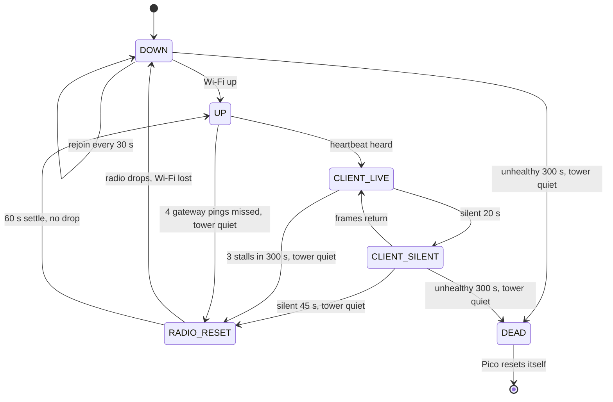
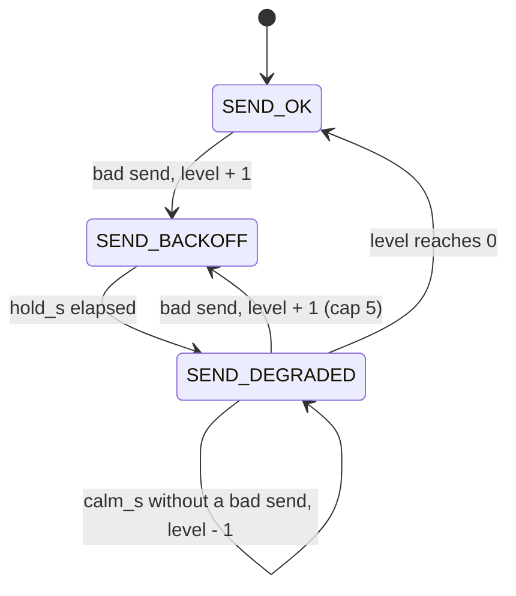

# Link health: concentrator <-> Sandbells

Who connects to whom: the Pico is the **server** (adafruit_httpserver on port
80, `/status` and `/ws`).  Sandbells connects to it twice: the ingest service
(`manage.py ingest_events`, Python websocket-client) and, while page 3 is
open, the kiosk browser (`farm_status.js`).  nginx and gunicorn are not in the
WebSocket path.  Up to `MAX_WS_CLIENTS` (4) clients.

## Wire

| direction | schema | type | when | stored by Sandbells |
|---|---|---|---|---|
| Pico -> all | `sand.event/v1` | `stroke` | each stroke | yes |
| Pico -> all | `sand.event/v1` | `link` | client connected / dropped / refused, wifi_lost, wifi_back, link_dead, reset | yes |
| Pico -> all | `sand.panel/v1` | `heartbeat` | every 5 s (`PICO_HEARTBEAT_S`) | no: page 3 widget only |
| client -> Pico | `sand.hello/v1` | `heartbeat` | every 5 s | (Pico only notes "heard") |

Every frame uses the same envelope: `schema, type, src, id, boot_id, seq,
tick_ms, utc_ms, err_ms, sync, acc, epoch, session, mode, srv, stratum, body`.
`seq` of `link` events is the normal event sequence (Sandbells' gap tracker
sees them); the heartbeat's `seq` is its own counter and `body.last_seq` is
the newest event seq of this boot.

`link` body: `what`, `reason`, `clients`, plus `peer`, `replay`, `level`, `up_s`,
`hb`, `count`, `down_s`, `ip`, `hold_s`, `why`, `refused` as relevant.

Heartbeat body: `panel` (6 x RGB, the ON phase of any blink), `panel_state`,
`link` (LED1 state), `tower`, `net` (`farm_ws.link_status()`: connects,
drops, refused, refused_backoff, replays_done, send_timeouts, silent_drops,
last_drop_reason, last_drop_age_s, clients, live, rx_age_s, send_state,
send_level, wifi_lost, rejoins, radio_resets),
`wifi` (`ip`, `rssi`), `sync`, `time` (`srv`, `stratum`, `last` burst result
with `why`, `peer` = stratum/leap of the last reply even when rejected, so a
sandmon GPS NO Lock shows as stratum 16 / leap 3), `last_seq`, `uptime_s`,
`last_reset`, `watchdog`, `mem_free`.

## Rules (code constants, no settings)

* Pico: a client that has sent a text frame must keep sending; silent
  `CLIENT_SILENT_S` (20 s) -> dropped.  Clients that never send (old ingest,
  debug listeners) are not timed out.
* Pico: every send has a deadline (`SEND_TIMEOUT_S` 0.4 s).  adafruit_httpserver
  4.8.2 `send_message()` / `close()` retry EAGAIN for ever on a full TCP
  buffer, which froze the whole concentrator on a dead peer.  `ws_bounds.py`
  (boot prints `ws bounds: on`, `request bounds: on`) puts deadlines on the
  library's own waits: reply/handshake send 0.3 s, rest of a frame 0.3 s, one
  HTTP request 0.3 s.  A bound that passes drops that one client.  The numbers
  live in the table at the top of `link_health.py`; `ws_bounds.py` and
  `farm_ws.py` read them from there.
* Pico: one `farm_ws.poll()` is held to `POLL_BUDGET_S` (1.0 s): every phase
  (library request, refusal closes, replay chunk, client reads) stops when the
  budget is spent and carries on the next 50 ms turn.  See "Send path" below.
* Pico: the last `REPLAY_N` (32) events are replayed to a new client, a frame
  per poll turn (more slowly, fewer, or not at all after a slow send: the
  `SendPath` table); Sandbells ignores duplicates (UNIQUE src, boot_id, seq).
  Live events for a client that is still being replayed queue behind the
  replay, so the order stays seq order.
* Pico: LED1 green = a heartbeat client heard within 20 s (before any client
  has sent a heartbeat this boot, any client counts, as before).
* Pico: Wi-Fi supervision every 2 s: lost -> LED1 orange (`no_wifi`), clients
  dropped, rejoin every 30 s (120 s while ringing; a join blocks sensing up to
  10 s per network, watchdog paused), server rebound if the IP changed, SNTP
  started if boot had no Wi-Fi.
* Pico: Wi-Fi "up" but nothing heard for `LINK_DEAD_S` (45 s, tower
  inactive, after a heartbeat client was seen this boot): one radio off/on
  per silent spell.
* Pico: an unhealthy spell (Wi-Fi down, gateway ping failing, or a heartbeat
  client gone silent) is tracked across radio resets and rejoins.  If it lasts
  `PICO_RESET_S` (300 s) with the tower quiet, `microcontroller.reset()`.  This
  does not need the hardware watchdog: a wedged Wi-Fi stack never heals itself
  (it took an mpremote Ctrl-D or a power cycle).  A working gateway ping, a live
  client, or `CALM_S` (90 s) of Wi-Fi up with no bad sign ends the spell, so a
  blip with no client and a router that ignores pings never resets.  At most
  one reset per spell; a rebooted Pico starts a new spell.
* Pico: repeated stalls.  A poll pass that takes `STALL_S` (5 s) or more is a
  stall (the Wi-Fi chip blocking inside one call: the logs show 10 s).
  `STALL_N` (3) stalls within `STALL_WINDOW_S` (300 s), tower quiet, ask for a
  radio reset even if clients keep reconnecting, at most one per
  `RADIO_RESET_SETTLE_S` (60 s); stalls also count as a bad sign for the 300 s
  Pico reset.
* Pico: Wi-Fi up but the server not running (the link dropped between the
  join and `start_server`: "Cannot start server on None:80") -> try to start
  it every `SERVER_RETRY_S` (10 s).
* Pico: a network entry in `settings.json` may carry `"static_ip"`: after the
  join the Pico keeps DHCP's netmask, gateway and DNS and swaps only its
  address (an extender hid the Pico's MAC from the router's reservation).
  The address is set even when DHCP gave the same one: setting it stops the
  DHCP client, which otherwise moved a matching lease to .253 two seconds
  after the join (2026-10-28 13:52).
* Pico LED6 (tower inactive): white = synced, amber = holdover (time server
  lost; strokes still carry utc_ms, err_ms grows), red = never synced.
* Sandbells ingest: hello every 5 s; once a Pico heartbeat was seen on the
  connection, `PEER_SILENT_S` (20 s) without a frame -> reconnect.  TCP
  keepalive 10/5/3.  Backoff resets only after a connection that delivered
  frames.

## State diagram (Wi-Fi and clients)

The state name is only a label; the reset decisions are guarded by flags
(see `src/link_health.py`).



The 300 s timer covers the whole bad spell, across radio resets and rejoins.


## Send path: why a new client could freeze the Pico for 10 s

Observed 2026-10-28 12:51-12:53 (Wi-Fi through an extender, Sandbells kiosk at
192.168.0.106):

```
12:51:52 link client_dropped {'up_s': 10.0, 'reason': 'replay too slow (errno 110)', 'hb': False, 'clients': 0}
12:51:53 loop late 9.2 s (survey idle, clients 0)
12:51:55 WS client connected (1 client)
12:52:05 WS client dropped: replay too slow (errno 110) (0 clients)
12:52:05 ws poll took 10.1 s: server 0.0, replay 10.0, read 0.0 (0 clients)
12:52:05 link client_connected {'clients': 1, 'peer': '192.168.0.106', 'replay': 32}
...
12:53:26 ws poll: [Errno 116] ETIMEDOUT: send timeout 1.5 s ; ws poll took 9.9 s: server 9.9
```

Cause (read from the CircuitPython 10.0.3 source,
`ports/raspberrypi/common-hal/socketpool/Socket.c`, `lwip_tcp_send()`; not
measured on the Pico).  When lwIP's `tcp_write()` returns `ERR_MEM` (the send
queue holds more unacknowledged segments than lwIP can queue or the heap
allows), the C code retries `for (i = 0; i < 200; ++i) { ...;
mp_hal_delay_ms(50); }`: up to 200 x 50 ms = **10 s inside one `socket.send()`**,
also on a non-blocking socket (its comment says so).  The Python deadlines
(`REPLAY_BUDGET_S` 1.5 s between frames, `_send_frame`'s 1 s, `ws_bounds`'
1.5 s) are only looked at after `send()` returns, so they cannot shorten it:
the first frame that hits `ERR_MEM` costs 10 s, the budget check then sees
"> 1.5 s" and drops the client with `replay too slow (errno 110)`.  Replaying 32
frames of ~0.5 kB in one turn into a new client over an extender (delayed ACKs)
is exactly what fills that queue.  The display reconnects at once, gets the
same 32 frames, and the Pico blocks again: a storm every 4-14 s.  While blocked
the Pico answers no ping or /status and the sense loop reports `loop late`.
Everything in `ws_poll_task` shares that one loop.  The same stall can hit the
handshake or a 503 (`server 9.9`).  The `errno 116` of the last line is
newlib's ETIMEDOUT (`ws_bounds` takes it from `errno`); `farm_ws` used to
hard-code 110, so those timeouts were not counted in `send_timeouts`.

Python cannot interrupt that C sleep, so the fix is to stop asking for it and
to stop repeating it: pace the replay so the queue never fills, notice a slow
send at once, and refuse the instant reconnect for a bounded, growing time.
That policy is `SendPath` in `src/link_health.py`; `farm_ws.py` asks it and
obeys.

### States

| state | accepts a new client | replay | meaning |
|---|---|---|---|
| `SEND_OK` | yes | `REPLAY_N` 32, 1 frame / 0.1 s | no bad send lately (level 0) |
| `SEND_BACKOFF` | **no**: 503 + `Retry-After`, a few hundred bytes, no handshake | n/a | a send was slow or failed; hold `hold_s` of the current level |
| `SEND_DEGRADED` | yes | per level (table) | hold over; gentler replay until `calm_s` without a bad send |

A *bad send* is a send, handshake, close or whole poll that failed, or took at
least `SLOW_S[kind]` (replay 0.2 s, live 0.3 s, server 1.0 s, close 0.15 s,
poll 1.5 s) even though it succeeded.  A slow replay frame drops that client;
a slow live frame only informs the model (a live client is never dropped for
being slow, only when the send times out, as before).

### Levels (`SEND_LEVELS`)

| level | hold_s | replay events | frames per turn | gap | calm_s before the level falls |
|---|---|---|---|---|---|
| 0 | 0 | 32 | 1 | 0.10 s | n/a |
| 1 | 2 | 32 | 1 | 0.25 s | 7200 |
| 2 | 4 | 16 | 1 | 0.50 s | 7200 |
| 3 | 8 | 8 | 1 | 0.50 s | 3600 |
| 4 | 16 | 4 | 1 | 1.00 s | 1800 |
| 5 (cap) | 30 | 0 | 0 | n/a | 1800 |

Each bad send from `SEND_OK` or `SEND_DEGRADED` raises the level by one (cap 5),
so retries that keep failing back off 2, 4, 8, 16, 30, 30 s and the replay
shrinks to nothing.  Failures of clients that were already connected during a
hold do not raise it again.  `calm_s` is deliberately hours: a level that was
needed once must not be given up within the same ringing session, otherwise a
link that needs it would flap between levels and stall once per `calm_s`.

Limits per poll (the same table): `POLL_BUDGET_S` 1.0 s; library request read
0.3 s; library reply/handshake/503 0.3 s; frame to one client 0.4 s (shortened to
what is left of the budget, keeping 0.1 s for the close); close frame 0.1 s.



Transitions are the `SEND_TRANSITIONS` dict; a (state, event) pair that is not
in it changes nothing.  A test checks that this diagram lists every entry.

### What the replay trade-off costs

A display that connects while the model is at level 3 or higher gets fewer than
32 events; strokes older than that, made while no client was connected, are not
re-sent by the Pico (Sandbells' gap tracker will show the hole).  That is the
price of never letting a catch-up hold the sense loop.  Level 0-2 keep the whole
32 (level 1) or 16 (level 2).

### What to look for in the serial log after deploy

New `link ...` lines (also stored by Sandbells as `link` events):

```
link send_backoff {'level': 1, 'hold_s': 2.0, 'replay': 32, 'why': 'replay slow 10.00 s', 'clients': 0}
link send_degraded {'level': 1, 'replay': 32, 'refused': 3, 'clients': 0}
link send_calmer {'level': 0, 'replay': 32, 'clients': 1}
link send_ok {'refused': 3, 'clients': 1}
```

* A healthy Pico prints none of them and `ws poll took` never appears.
* One `send_backoff` followed by `send_degraded` and no more: the ladder
  worked (one stall, then a replay that fits).  `loop late` should appear at
  most once around it.
* `send_backoff` with a rising `level` several times a minute: the link cannot
  take even the smallest replay.  Look at `rssi`, the extender, and
  `radio_resets` in the heartbeat.  Repeated 5 s+ polls still escalate to the
  Wi-Fi radio reset (`STALL_N`).
* `ws poll took N s: server 0.0, replay 10.0` with N near 10: a single
  `socket.send()` is still sleeping inside lwIP.  It should now happen once per
  episode, not every 4-14 s.
* `client_dropped ... 'reason': 'replay slow (errno 110)'` / `'replay backlog'`:
  the replay was cut short on purpose.
* The heartbeat `net` has `send_state`, `send_level`, `refused_backoff` and
  `replays_done`; `/status` shows the same.
* Sandbells (kiosk and ingest) must wait before reconnecting: the nginx/ingest
  log should show 503 on `/ws` with `Retry-After`, not a connect per second.

Not verified: all of this is tested on CPython with fakes (an lwIP queue model
reproduces the 10 s stall and the storm, see `tests/test_farm_ws.py`); none of
it has run on a Pico.
