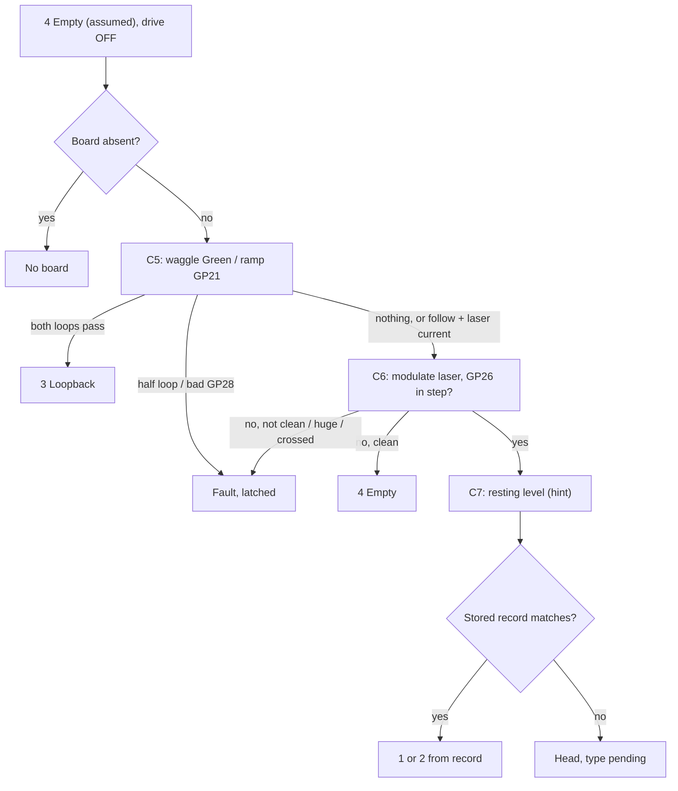

# Sandswing commissioning and acceptance spec (draft, 2026-10-18)

For the mentor and wyleu. A proposal; nothing is deployed. Sources: `sandswing_hardware_model.md`, `mux_select_draft.py`, `abc_fix/`, `sntp_pico.py`, mux_blend `aec9581`. Code changes are in `sandswing_code_changes.md`.

Requirements are numbered so they can be cited (for example **T4**). **SHALL** means it must be met and is testable. **[A]** marks an assumption that needs a yes or no.

## 1. Purpose and user
- Goal: the Sandbells screens are trusted. Each stage proves the next:
  1. loopback plugs prove the concentrator;
  2. line-up proves which bell is on which channel;
  3. a reference reflector proves each head;
  4. a toll count proves the counting.
- First target: one sensor on **bell 8 (tenor)**, which is tolled for funerals. Sandbach has 8 bells; the others follow the same steps.
- The end user is **a disinterested little old lady**. She never touches settings. Lights mean one plain thing each (section 9).

## 2. Prerequisites
- **P1** One owner for A/B/C (GP18/19/20). This is the `MuxAddress` fix in `abc_fix/`; it is tested, and GP27 is never claimed.
- **P2** Threshold PWM on GP21 at `threshold_mux.pwm_hz` = 20000 (about 20 kHz, scope-tested), read from settings. **Never on GP28**, which shares slice 6A with GP12 (bell 5's laser).
- **P3** The startup PWM slice check SHALL refuse two pins on one slice and channel, or two frequencies on one slice.
- **P4** The `/ws` route is restored in `farm_ws.py` (it was removed in `4bb04aa`).
- **P5** NeoPixel count = 6, set in settings.
- **P6** Drive gate: no laser or threshold drive until the channel is classified (C2).
- **P7** Lasers stay true PWM on GP8–15 (W1).
- **P8** Time sync and millisecond event stamps (section 7).

**Site rule: island network, no internet.** The Sandbells Wi-Fi is deliberately not connected to the internet.
- **N1** No feature SHALL assume the internet, at run time or at boot. That rules out NTP pools or fallbacks, CDNs, online time-zone data, package fetches and licence checks.
- **N2** The only time sources SHALL be the local GPS servers (`sandgps*.local`). Today's Sandbells config breaks this: `install-steps/sandbells-time-select.sh:74` and `research_files/setup-initial.sh:121` write `pool ntp.ubuntu.com iburst` into `chrony.conf`. Those lines must be removed. Pages that load script from CDNs must be served locally instead: `changes/bells/templates/bells/d3.html:5-6` (googleapis jQuery, d3js.org) and `bells_d3.html:6` (d3js.org).
- **N3** Software SHALL be installed from media brought to site, or before deployment. `apt` and `pip` steps in `install-steps/` assume a network. Time-zone rules SHALL come from local files or code (T18).
- **N4** When GPS is lost, the Pico and the Pi SHALL hold over on the last good offset and drift, with a growing error bound shown on LED 1 and on Sandbells (T17).

## 3. Channel classes (the user's numbering, used in logs, payload and code)

| # | Class | Plugged in | Proven by |
|---|---|---|---|
| 1 | Old head | PT only | A head exists (C6), and with the reflector in, the threshold sweep does **not** move Blue/White (R2) |
| 2 | New head | PT + LM393, threshold on Orange | A head exists (C6), and with the reflector in, the sweep **does** move Blue/White (R2) |
| 3 | Loopback | Green→Blue/White, Green/White→Orange | Digital and analog loops both pass (C5) |
| 4 | Empty | Nothing | **The default**, kept only if C5 and C6 find nothing and the readings are clean |

Other states:
- **Head, type pending**: C6 passed, but the reflector stage hasn't run.
- **Fault**: the evidence contradicts itself. It latches.
- **No board**: channels 5–8 while board 2 is absent; they are never probed.

## 4. Classifier (every boot and every tower-idle rescan; no reflector)
- **C1** Every channel SHALL start as **4 Empty** with drive off. Each other result is proven by evidence, in order. The first result proven ends the sequence.
- **C2** Drive SHALL stay off until the channel is 3, or a head of known type. The steps use short probes only.
- **C3** Decisions SHALL use measured levels and responses, never a timer running out.
  - A response counts only if it beats the measured noise by a margin, on every cycle.
  - An unclear step repeats. After N tries (a count) the channel is **Unknown**, with drive off.
- **C4** Waits SHALL be derived, then checked by "two averages within 1 LSB":

  | Wait | Derivation | Today |
  |---|---|---|
  | Threshold step (10k/100nF → 10k/1µF) | τ from `threshold_mux.rc`; τ·ln(step ÷ 1 LSB12) + fast pole | τ 20.5 ms; full step 171 ms; 1/8 step about 128 ms |
  | Hold cap follows node | Ron·Ch·ln(FS ÷ 1 LSB12) | 0.4–0.8 ms |
  | GP26 settle, Blue/White loop delay (Dot A filters unknown) | Measured in C5 on a loopback; the analog loop returns on Green/White, the line that carries head current | per channel |
  | Hold-cap refresh | The user's scope droop tests (the datasheet's 20 ms is only a cross-check) | `refresh.interval_s` |

  **[A]** The very first waggle uses the Dot A values or a scope-measured delay. After Stage A, the measured values are used.
- **C5 Loopback test.**
  - Waggle Green off/full on for K cycles. Blue/White SHALL follow every edge with a steady delay; the delay is stored.
  - Ramp GP21 in derived steps. GP28 SHALL be straight, with slope 0.83 = 100k ÷ (100k + 20k) when loaded, or 1.0 unloaded. GP26 ÷ GP28 SHALL be ≥ 0.93 at every step.
  - Results:
    - Both loops pass → **3**.
    - Half passes, with no laser current → Fault.
    - Digital follow **with** laser current → a head seeing its own beam; go to C6.
    - Bad GP28 ramp → Fault.
- **C6 Head exists.** Modulate the laser off/on for K cycles. GP26 varying in step on every cycle, above the Stage A noise band, proves a head; its current is stored as the reference.
  - Nothing, with clean readings → **4**.
  - Current with the laser off, a huge step, or GP28 moving with the laser → Fault.
- **C7 Resting level (hint only).** Laser off; read Blue/White with the pull-up, then the pull-down. Low hints at old; driven high or switching hints at new; following the pulls means nothing drives it. The hint is logged and never decided on.
- **C8 Result** is **Head, type pending**. If this bell's stored head record matches the hint and current, the record's type is used instead.



## 5. Reflector stage (type, base threshold, laser response)
All tests beyond "a head exists" need a **reference reflector** between the laser and the PT. A dark PT may sit outside the 0–3.3 V threshold range, so the type test is done with the reflector in the beam.
- **R0** The reflector SHALL give the same result on every head and at every socket: same material, distance and angle, held in a jig. Ideally it matches the real wheel band.
- **R1** Optical loop: laser off/on for K cycles. Blue/White SHALL follow (for a new head, with the threshold at mid-range). No follow → Fault, not old.
- **R2** Type test: hold the laser at the commissioning duty and sweep the threshold up and down at least twice, with derived settles and the range confirmed on GP28.
  - Repeatable switching → **2**.
  - R1 followed, but there is no response to the sweep → **1**.
  - Not repeatable → Unknown.
  - R2 overrides the C7 hint; any disagreement is logged.
- **R3** Base threshold (new heads): set between the switching points with the reflector in and out. "Between" is a setting, such as the midpoint. It is stored per head. Old heads have no threshold; their only adjustment is the laser duty.
- **R4** Knee curve: at the base threshold, step the laser duty from full down to where the reflector is lost. At each duty, record GP26 current, whether the reflector is seen, and the up/down switching thresholds.
  - GP26 SHALL rise in line with duty; this is the PWM hardware check (W4).
- **R5** Head record, keyed by bell **[A]**: `{bell, type, ref_ma, laser_duty, base_threshold, knee[], reflector, date}`. It follows the head through the bell map.

## 6. Laser PWM as a second control (fitted now, used later if needed)
- **W1** GP8–15 SHALL stay `PWMOut`, never plain digital. C5 and C6 use duty 0 and full only.
- **W2** A per-head `laser_duty` (default full, or the R4 value) replaces `wheel.laser_duty` (32767 today), which stays only as a fallback.
- **W3** Slices: GP8/9 = 4A/B, 10/11 = 5A/B, 12/13 = 6A/B, 14/15 = 7A/B. **Duty is per laser; frequency is per pair**, so there is one `laser_pwm_hz` (1 kHz). P3 enforces this.
- **W4** Hardware, for all 8 heads now: the transistor drive, laser module driver and any Green-line filter SHALL let duty change the average laser power. R4 is the test.
- **W5** Until W4 and question Q9 are settled, the bell runs at full duty, and part duty is used only in R4.
- **W6** The payload and logs carry `laser_duty`, `base_threshold` and the knee curve.

## 7. Time and timestamps
**Two accuracy classes on the local Wi-Fi.**
- **ms class**, for bell-ringing events. Strokes are about 2 s apart (`wheel.t_ms` 2500 per whole pull), and hand/back intervals and striking accuracy differ by tens of ms. With 1 s stamps (`time.time()`, or `adafruit_ntp`'s whole seconds), a 2 s interval is useless. The target is a few ms in UTC, with 1 ms resolution.
- **s class**, for tower-clock confirmation and session scheduling. The time must be right to the second, which needs an error bound under 0.5 s.

**Today.**
- Sandbells (Pi 3) is disciplined by chrony to `sandgps*.local` (GPS, stratum 0/1; `sandbells-time-select.service`, `time_hosts`).
- The Pico has no sync. `time.time()` starts at 2000 each boot.
- `concentrator.py:222` sends `ts=time.time()`, and `sand_status.py:97` rounds `ts` to whole seconds.
- `tower_watch.gps_tick` exists, but nothing calls it.

Requirements:
- **T1** Events SHALL be stamped on the Pico at edge detection with `supervisor.ticks_ms()`, never `time.monotonic()`.
  - The detection delay SHALL be bounded and stated. The 20 ms sense-loop sleep is too coarse.
  - Recommended: `keypad.Keys` events, whose `timestamp` is `ticks_ms`, with a short scan interval.
- **T2** `ticks_ms` wraps at 2^29 ms (about 6.2 days), and first wraps about 65 s after power-on. Stamps SHALL be extended by a wrap counter (`TickClock`), and the extension SHALL be refreshed at least every half wrap (the SNTP loop does this).
- **T3** `tick_ms` in payloads SHALL be the extended tick (ms since boot), sent with a `boot_id`.
- **T4** A custom SNTP client (`sntp_pico.py`) SHALL query the GPS server **by IP** from settings (`time.ntp_ips`). CircuitPython's DNS can't resolve `.local`. **[A]** Optional mDNS discovery is allowed, with the IP as fallback. `time.ntp_ips` may list several sites' servers; only those on the device's subnet are used (all, if none is). Before each free-mode burst each candidate is probed once (short timeout); the lowest valid stratum wins, then the lowest RTT, and the burst goes to that server only. A server change clears the fit and RTT history and starts a new epoch; there is no reselection while ringing. Until the first sync, bursts are retried every 15 s.
- **T5** Every `interval_s` (default 300 s), it SHALL send a burst of N queries (default 8). The minimum-RTT sample is kept. Offset = ((t2 − t1) + (t3 − t4)) / 2, with t1/t4 from extended ticks and t2/t3 from the server's 64-bit NTP stamps.
- **T6** A sample SHALL be rejected when any of these hold:
  - stratum is 0 or 16, or leap indicator is 3 (unsynchronised)
  - the reply doesn't echo our transmit stamp
  - its RTT is above median + k·MAD of recent accepted RTTs (from the measured distribution, not a fixed limit)
- **T7** Drift SHALL be estimated by a linear fit over recent good samples. This is the *estimate*; `utc_ms(tick)` comes from the *issued mapping*, which follows the estimate only as T21–T23 allow.
- **T8** The error bound SHALL be RTT/2 + 1 ms + fit residual + drift uncertainty × age. The drift uncertainty is 3σ of the fitted slope, or the crystal tolerance until there are 3 samples.
- **T9** Sync state SHALL be one of:
  - `unsynced`: no good sample yet
  - `synced`
  - `stale`: no good burst for `stale_after` intervals
  - `held`: ringing mode, mapping frozen on purpose (T21). Not a fault.
- **T10** Every event payload SHALL carry `tick_ms`, `utc_ms` (null while unsynced), `err_ms`, `sync`, `acc` (T16), `epoch`, `session`, `mode` (T24), and `srv`, `stratum` (time server and its stratum; null while unsynced).
- **T11** A network call SHALL stall the sense loop for no more than `timeout_s` (default 0.25 s), and network errors SHALL never leave the sync loop.
- **T12** Sandbells SHALL record its own receive time for latency statistics. It SHALL NOT replace the Pico stamp.
- **T13** status-v1 SHALL add `utc_ms`, `tick_ms` and `sync`. `ts` = `utc_ms // 1000` when synced, else 0; it stays in whole seconds only for schema compatibility.
- **T14** The boot record SHALL log the sync state, servers, the chosen server (`srv`, `stratum`, `disagree`), last burst (RTT, offset, drift) and counters.
- **T15** The day boundary (`gps_day` → `tower_watch.gps_tick`) SHALL be raised once when synced UTC crosses midnight. **[A]** By default this is UTC; a setting gives a local offset. While unsynced, the existing local day count continues.
- **T16** `accuracy_class(tick)` SHALL report `"ms"` (err ≤ 10 ms), `"s"` (err ≤ 500 ms) or none. It is in every stamp (`acc`) and in status-v1. A consumer SHALL use a time only for the class it needs.
- **T17 Holdover.**
  - When bursts fail, the Pico SHALL keep `utc_ms` from the last offset and drift and report `stale`.
  - The drift uncertainty SHALL never be below `hold_ppm` (default 5 ppm, for crystal wander the fit can't see), so the bound keeps growing. For example, 6 h of holdover is about 108 ms: still class s, no longer class ms.
  - The Pi's chrony SHALL do the same from its driftfile. Its bound is root dispersion + root delay / 2, read from `chronyc tracking`.
  - Neither device SHALL ever present holdover as synced.
- **T18** UK local time SHALL be computed from UTC with the built-in UK rule: BST from 01:00 UTC on the last Sunday of March to 01:00 UTC on the last Sunday of October. No time-zone data is fetched (N3).
- **T19 Acceptance.**
  - (a) Over Wi-Fi, |Pico UTC − Pi chrony UTC| SHALL be ≤ 5 ms (95 %) and always within `err_ms`. It is checked by a WebSocket ping (Pi send and receive times around the Pico's `utc_ms`) every minute for 24 h.
  - (b) During each toll, stroke intervals computed from `utc_ms` and from `tick_ms` SHALL agree within the error bound. The session length on Pico UTC SHALL match the Pi's receive times within latency.
  - (c) Holdover: switch the GPS servers off for 6 h. When they return, the Pico's real error (measured on the first good burst) SHALL be within the `err_ms` it reported just before. Class s SHALL be shown correctly against the tower clock throughout.

**Ringing view (T20–T25).** The tower already knows when it is ringing: `TowerWatch.tower` is `"active"` / `"ringing_down"` / `"inactive"` (`tower_watch.py:79-81`, set in `_reduce()` `:151-168`; only a `RINGING` report, `:74` and `:117`, counts as an edge). The concentrator tracks transitions (`concentrator.py:164`, `:350-352`) and reports it in status (`:221`). That flag picks the clock's view.
- **T20** `SntpClock` SHALL have two modes, set by `set_ringing(bool)`: `free` when the tower is `inactive` (or `boot`), `ringing` when it is `active` or `ringing_down`.
- **T21 Ringing.** At session start the issued mapping SHALL be frozen as one straight line (offset and rate at that moment). Until the session ends, `utc_ms` SHALL be a pure function of tick, constant-rate and strictly increasing. Lock loss and regain SHALL NOT change it. Samples MAY be taken for diagnostics (`ring_sample`, default off, `ring_burst` 2 every `ring_interval_s` 900 s); they refine the estimate only. With sampling off, ringing makes no network calls.
- **T22 Leaving ringing, and every free-mode update.** The correction c = estimate − issued, at now:
  - c > `step_ms` (default 100 ms): **step forward**, new epoch, logged.
  - otherwise (any backward correction, or a small forward one): **slew** at `max_slew_ppm` (default 500 ppm, so a 2 s stroke interval is distorted ≤ 1 ms), logged with c and the slew time. A backward 100 ms takes 200 s.
  - Nothing ever steps backward.
- **T23 Monotonic guard.** `utc_ms` SHALL never decrease with tick, across epochs, slews and sessions. `stamp()` also clamps any decrease in issue order and counts it (`guard_hits`, expected 0).
- **T24** `stamp()` SHALL carry `epoch` (+1 on every mapping change: first sync, freeze, step, slew), `session` (+1 at each ringing start) and `mode`.
- **T25 Unsynced at ring start.** If a session starts while unsynced, `utc_ms` (and `err_ms`, `acc`) SHALL stay null for the whole session, even if sync arrives mid-session. `tick_ms` is always present. Times for the session can be rebuilt from ticks afterwards.
- **T26 Drift in a long ring.** During ringing `err_ms` SHALL keep growing as drift uncertainty × time since the last fit, plus any gap between issued mapping and estimate. Worst case at 4 h:
  - uncorrected crystal, 50 ppm: 4 × 3600 s × 50 ppm = **720 ms** (fails class s);
  - fitted drift, uncertainty floored at `hold_ppm` 5 ppm: **72 ms** (+ RTT/2 + 1 ms ≈ 75 ms): class s, not class ms. Class ms (≤ 5 ms) lasts only about 7 minutes after the last fit ((5 − ~3 ms) ÷ 5 ppm).
  - The accuracy class SHALL report this honestly (`acc` drops from `ms` to `s` during a long ring).
  - **Relative timing is unaffected:** stroke and hand/back intervals use tick deltas on one straight line. Error = interval × drift error: 2 s × 5 ppm = 10 µs. Intervals within a session stay ms-accurate for the whole 4 h.

### 7a. Simulator sessions (silent or simulated ringing, for training)
The simulator uses the same sensors and stamps. Sound output is the noise risk, so it is gated by GPS time:
- **S1** Allowed windows (quiet hours inverted) SHALL be settings, for example `simulator.windows: [{"days":"Mon-Fri","start":"18:30","end":"21:00"}]`. They are in UK local time, using the built-in rule (T18).
- **S2** The device that makes the sound SHALL enforce the windows with its own clock: the Pi via chrony, the Pico via `SntpClock`.
- **S3** Sound SHALL start only when **all** of these hold:
  - the clock is class s or better;
  - now is inside a window;
  - now + `guard_s` is still inside it (default 60 s), so nothing starts in the last minute.
- **S4** Sound SHALL stop at the window end, **even mid-session**, measured on the synced clock. It fades over at most `fade_s` (default 2 s), ending at or before the window end.
- **S5 Fail-safe.** If the clock is unsynced, or its bound grows past the s-class limit (0.5 s), sound SHALL NOT start, and running sound SHALL stop. Silent practice (sensing, counting and display, but no audio) is always allowed.
- **S6** Every start, stop and refusal SHALL be logged, with the reason (window, sync or guard) and the time class.
- **S7 Test.** With a window ending 2 minutes ahead: sound stops within `fade_s` of the end. Pull GPS and let the bound pass 0.5 s: sound stops and won't restart. With the clock unsynced from boot: sound never starts.

## 8. Test journey
**Stage A: loopback check.**
- **J1** Fit loopbacks in all available channels (1–4). Every channel SHALL reach **3** for three boots in a row.
- **J2** Calibration SHALL be stored: GP28 gain/offset, GP26 floor and noise, settle and loop delays, and the loopback spread.
- **J3** Unplug one loopback: that channel SHALL become **4** (GP28 slope 1.0). Replug it: **3** again.

**Stage B: line-up.**
- **J4** Replace one loopback with bell 8's cable. Only that channel changes, and it SHALL show **Head, type pending** with its hint.
- **J5** Identify the bell by movement: the ringer moves bell 8, and the channel that sees edges is proposed. The commissioner confirms on Sandbells.
- **J6** The map is a record, not code. `bells.map` (e.g. `{"8": {"channel": 1}}`) is kept with its history on Sandbells and copied into the Pico settings. **[A]** This is because `boot.py` doesn't remount, so the Pico can't write.
- **J7** Swap test: after a head and a loopback swap sockets, the concentrator SHALL flag the map mismatch until it is re-confirmed.

**Stage C: reflector stage** (each head, and after any head change).
- **J8** Fit the reflector jig and start "reflector test" on Sandbells. R1–R4 SHALL prove the type, set the base threshold and store the knee curve. Remove the reflector, and the channel light changes from pending to ready.

**Stage D: tenor ready.**
- **J9** Bell 8 shows green (new) or yellow-green (old). Its head record is stored, and the hold-cap refresh has no stale channels.
- **J10** Practice pulls: about 20 known strokes SHALL be counted exactly. They also teach the stroke shape (A1).
- **J11** Time is `synced`, and T19(a) has passed. During tolls `sync` is `held`, `session` steps once per toll, and `guard_hits` is 0 (T21, T23).

## 9. Toll count acceptance (Stage E)
- **A1** One stroke = one pass of the 2-1-4 wheel strip, seen as a cluster of edges. Clusters are split at gaps much longer than the in-cluster gaps; the split is learned in J10, for example as half the median stroke interval.
  - `BellMachine` emits `started` only on leaving rest, so a per-stroke counter is needed.
- **A2** Hand/back SHALL come from the band order (2-then-4 or 4-then-2), checked for alternation. Until that decoder exists, it is inferred from alternation and shown "(assumed)". **[A]** The first stroke after a stand is a handstroke.
- **A3** The display SHALL show, large: bell and channel; strokes (with hand/back); whole pulls; bursts (so tellers appear separately); start time (synced UTC); and a fault line only if there is one.
- **A4** No buttons. A session starts at the first stroke after a stand or quiet spell, and ends when the bell is stood or quiet for more than `lost_mult × t_ms`.
- **A5 Pass** (checked by the tester against the written-down age and tellers):
  - whole pulls in the age burst = age;
  - strokes = 2 × age (+ tellers);
  - |hand − back| ≤ 1;
  - no fault or lost events;
  - T19(b) holds.

  **Accept** if three funerals this week all pass. On a mismatch, look at the stroke intervals: about 2× the median means a missed stroke, well under the median means an extra one.

## 9a. Bell state model (one head per bell)

Optics: one laser/PT head per bell, aimed at the wheel rim. Unit u = 12-15 mm.
- Stage 1 strip (fitted first): 4u reflect, 1u dark, 2u reflect. The dark 1u is aligned so a rested bell sits with the head on it (no return).
- Stage 2 (later, fitted with care because it means approaching a stood bell): two further strips, one at each stood position (handstroke, backstroke).

States (user's names): RESTED; RINGING (left or right, i.e. direction of the last crossing); STOOD_HAND (default, sally in front of the ringer); STOOD_BACK (sally above the head). Plus a transitional AT_BALANCE and FAULT (lost sight / impossible timing). MIDI is sent on each transition between states (as well as the strike notes).

B1 Direction: from the order of pulse widths in one crossing (4u then 2u, or 2u then 4u), judged by ratio, not fixed ms.
B2 Speed: from pulse width / known u.
B3 Stage 1 RESTED: the bell's swings across the strip decay and it settles on the dark gap.
B4 Stage 1 STOOD (inferred): a crossing that carries on and never returns. Hand/back from the direction of that last crossing. Shown as "assume up" (unsafe), never as "safe".
B5 Stage 2 STOOD (confirmed): continuous reflection from a stand strip; which strip gives hand/back.
B6 Safety: any state that is not positively RESTED is treated as "bells may be up". The display must never show "safe" on inference alone. A rested bell must be confirmed by the decay pattern. After boot with no history, the state is UNKNOWN and shown as "assume up".
B7 Plug insert/removal (hot-plug of a loopback or head) triggers a rescan, never RINGING / tower active.
B8 No fixed swing time or stand hold: the period and the hold are learned per bell from observed swings (bell_machine.py currently has 2500 ms / 350 ms defaults to replace).
B9 Code base: bell_machine.py already has the states and events (started, direction, top, checked, stood, lost). Changes: one wheel input instead of separate stand_hand/stand_back for stage 1; add the 4-1-2 pulse decoder (not yet written); stood inference per B4.

## 10. Front panel and its echo
- **L1** One function, `panel_frame(stage, link, sync, channels, bell_map, activity)`, SHALL return six entries: `rgb`, `blink`, `state`, `text`, plus per channel `class`, `laser_duty` and `base_threshold`.
  - The GP16 strip (brightness applied here only), the NeoPixel rig and the WebSocket payload all use the same list.
  - The same entries also go to status-v1 as a "Panel" section with `color` and `color_alt`.
  - Blinking is drawn locally from the pattern name.

  Example payload:
  ```json
  {"type":"panel","seq":812,"tick_ms":...,"utc_ms":...,"sync":"synced","stage":"service",
   "panel":[[0,32,0],[0,32,0],[0,0,0],[0,0,0],[0,0,0],[8,8,8]],
   "blink":["steady","steady","off","off","off","beat"],
   "state":[{"led":1,"role":"link","state":"ws_client","text":"Display connected"},
            {"led":2,"role":"ch1","class":2,"bell":8,"text":"Tenor ready","laser_duty":65535,"base_threshold":30500},"..."]}
  ```
- **L2** Meaning first: **steady** = fine, **slow blink** = a person should act, **fast blink** = fault. Colour is a second cue.
- **L3** The LED table:

| LED | Stage A | Stages B–C | Service (lady) |
|---|---|---|---|
| 1 left: link + time | Green = Sandbells connected, time class ms. **Green slow blink = connected, time holdover (`stale`, class s only).** `held` (ringing) shows plain green while class ms, then slow blink once class s. **Green double blink = time `unsynced`, or bound > 0.5 s (no time).** Blue = Wi-Fi only. Amber = no Wi-Fi. Red fast blink = error. | same | same |
| 2–5: ch 1–4 | Dim white = classifying. Blue = loopback. Amber = empty. Red fast blink = fault. | Blue = loopback. **White slow blink = type pending (fit the reflector).** Cyan slow blink = reflector test. Green = new head. Yellow-green = old head. Amber slow blink = map mismatch. Red fast blink = fault. | Mapped bell ready: green (yellow-green if old), with a white flash per stroke. Unmapped: off. Mapped bell missing: amber slow blink. Fault: red fast blink. |
| 6 right: activity | Cyan slow blink = self-test. Cyan steady = passed. Red = failed. | Magenta = line-up mode | Dim white heartbeat = ready. Green = ringing. Amber = ringing down. Red = fault. Magenta = restarted after a crash (watchdog). |

Channels 5–8 have no LEDs; Sandbells shows them as text.

## 11. Logging (Pico → WebSocket → Sandbells; the serial `tee` is the fallback)
- **G1** Boot: firmware commit, settings hash, bell map, PWM slice table, `boot_id`, and the sync record (T14). Every record carries `acc` (T16).
- **G2** Each classification and reflector stage: readings, bands, spread, tries, result, hint/R2 disagreement, and the head record.
- **G3** Each stroke: `tick_ms`, `utc_ms`, `err_ms`, `sync`, Pi receive time, bell, channel, stroke number, hand/back (and whether assumed), interval, and the edge times in the cluster.
- **G4** Each session: start, end, totals, bursts, faults. For acceptance, also the expected age and tellers, and pass/fail.
- **G5** Map, laser-duty and threshold changes (old value, new value, why), and panel state changes.

## 12. Open questions
1. Laser current per head: 5 mA or about 25 mA? C6 and R4 measure it; please meter one head.
2. Are the tellers rung, and are they counted?
3. Does the toll start at handstroke (A2)?
4. Where does the stroke counter live: in `BellMachine` or beside it?
5. Bell map and head records on Sandbells (proposed), or should `boot.py` remount?
6. Dot A filter values (C4).
7. Is the NeoPixel rig driven from the payload (Pi) or from its own pin?
8. Refresh interval and dwell from the droop tests.
9. **Laser PWM vs sensor speed:** at 1 kHz, does the PT or LM393 follow the chopped light? If so, the options are head filtering, sampling in step with the PWM, or a higher per-pair frequency (W5).
10. **Head PWM hardware:** does duty change the average power on all 8 heads (W4)?
11. **Reference reflector:** material (a piece of the real band?), distance, angle, jig, and id (R0).
12. Is a head seeing its own beam in C5 correctly treated as a head?
13. RP2350 erratum E9 (pull-down): is C7's pull-down reading trustworthy?
14. Is the head record keyed by bell OK, or do heads need their own id (R5)?
15. **Time:** the GPS servers' fixed IPs for `time.ntp_ips` (DHCP reservations on the island network?). Is the Wi-Fi power-save latency acceptable for T19(a)? Is the day boundary UTC or UK local?
17. **Simulator:** the allowed windows (days and hours), the guard and fade times, and which device makes the sound: the Pi, the Pico (MIDI), or both (S2).
18. Where do installs and updates come from on site (N3): a USB apt/pip mirror, or images built off-site?
16. Is a `keypad` scan interval of a few ms acceptable on CircuitPython 10 alongside Wi-Fi (T1)?
