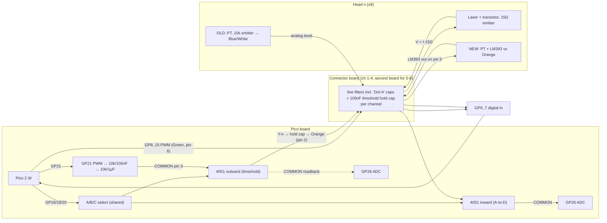

# sandswing concentrator: hardware model and cross-check (2026-10-18)

Sources: the mentor's descriptions (taken as fact), the board's current `settings.json` as pasted by the mentor (`/workspace/settings_current.json`, password masked), and a read-only review of `wyleu/sandswing` main `f295449` and `mux_blend` `aec9581`.
**[I]** marks my inference. Everything else is either the mentor's description or something I saw in the code.
**Update 2026-10-18 (user):** PWM slice history (GP28 → GP21), the ~20 kHz threshold PWM (scope-tested), and the two-process hold-cap refresh. The user's scope measurements outrank datasheet estimates; the datasheet numbers stay only as a cross-check. See sections 3, 3a, 5 (#1, #7, #14) and 11.

## 0. Top-level I/O map (mentor)

| Function | Count | Pico pins | Path |
|---|---|---|---|
| Digital in | 8 | GP0–GP7 | Blue/White (pin 5). Old-head analog PT level **or** new-head LM393 output, on the same wire |
| Digital / PWM out | 8 | GP8–GP15 | Green (pin 6): laser drive via the transistor in the head |
| Analog in | 8 | GP26 | inward (current-sense) 4051 COMMON; Y0–Y7 = ch 1–8; Green/White (pin 3) |
| Analog out | 8 | GP21 PWM (~20 kHz) → filter → outward 4051 COMMON (pin 3) → Y0–Y7 → per-channel 100 nF hold cap → Orange (pin 2) | GP28 monitors the filter node / COMMON |
| Former threshold PWM | — | **GP28 (do not revert)** | Was the threshold PWM until it was found to share RP2350 PWM slice 6 A with GP12 (bell 5's laser). Now analog monitor only (section 3a) |
| Select | shared | GP18 = A, GP19 = B, GP20 = C (confirmed) | both 4051s, channel n on Yn |
| LED strip | 6 × WS2813 | GP16 data | left status, ch 1–4, right status |
| Unused | — | **GP27: nothing** | (it crept into code and settings, see section 5) |

- Channels 1–4 are populated on connector board 1.
- Channels 5–8 are wired on the Pico board to an expansion connector for a future board 2. **[I]** Assumed: sense GP4–7, laser GP12–15, Y4–Y7. The I/O map supports this.
- Confirmed Blue/White pins: ch 3 = GP2, ch 4 = GP3. **[I]** ch 1 = GP0, ch 2 = GP1, consistent with the code's `sense [0..7]`.

## 1. Boards, heads, connector, front panel

- **Pico board:** Pico 2 W, both 4051s, the GP21 2-stage filter (10 k/100 nF → 10 k/1 µF), GP28 monitor on the outward COMMON, and the 100 kΩ pull-down on the inward COMMON (README:39).
- **Connector board** (ch 1–4): line filtering including "Dot A" caps, and the **per-channel 100 nF threshold hold caps after the outward 4051**.
- **Heads:**
  - Laser driven via a transistor with **15 Ω in the emitter**. That node (pin 3) is mainly there for loopback testing; it also shows laser current at 15 mV/mA.
  - Laser modules: ~5 mA, rated 5 V, built-in 91 Ω.
  - OLD head: PT with 10 k in the emitter; the emitter level goes out on pin 5.
  - NEW head: LM393 compares the PT (10 k collector load) against pin 2 and outputs on **pin 5** (same wire).
- **8P8C, T568B:**

| Pin | Colour | Role |
|---|---|---|
| 1 | Orange/White | spare (future) |
| 2 | Orange | threshold (held) |
| 3 | Green/White | 15 Ω emitter node |
| 4 | Blue | 0 V, PT side |
| 5 | Blue/White | PT sense / LM393 out |
| 6 | Green | laser PWM drive |
| 7 | Brown/White | 0 V laser switching return |
| 8 | Brown | +5 V |

- **Grounds:** pins 4 and 7 are split on purpose and join around the 15 Ω (star-ish).
- **Loopback plug:** straps **6→5** and **3→2**. It fits any socket and serves identification, wire test and blanking. **Not Ethernet/PoE; label it.**
- **Front panel:**

```
   [ 8P8C ch1 ] [ 8P8C ch2 ] [ 8P8C ch3 ] [ 8P8C ch4 ]
 (L1)        (L2)         (L3)         (L4)         (L5)        (L6)
 left       under ch1    under ch2    under ch3    under ch4    right
 status                                                         status
```

  - The strip is GP16, GRB, 6 LEDs. Index 0 = left status, index ch+1 = channel LED (ch 0-based), index 5 = right status.
  - Channels 5–8 have no panel LEDs. **[I]** Possibly on the future board.

## 2. Block diagram



## 3. Analog numbers

### GP21 threshold filter
- **Stages alone:** 159 Hz and 15.9 Hz. Loaded, the poles are **7.76 Hz (τ ≈ 20.5 ms)** and 326 Hz.
- **Settling after a duty change** (full-scale step): 1 % in 95 ms; 1 LSB12 in **171 ms**. A 50 % step takes ~157 ms. With a loopback 100 k load: ~143 ms.
- **PWM ripple** (50 % duty, peak-to-peak):

  | PWM frequency | Ripple |
  |---|---|
  | 1 kHz | ≈ 10 mV (12.6 LSB12) |
  | 2.29 kHz | ≈ 2 mV |
  | 20 kHz | ≈ 0.03 mV |

  Use **≥ 20 kHz on GP21**: ~7500 steps, ~12.9 bit. Lasers can stay at 1 kHz on other slices.
- **Measured (user):** threshold PWM is **about 20 kHz, scope-tested, script lost**. It started at 1 kHz and was raised after scope checks. The REPL test script is gone; the evidence left in the repo is `board_pico.py:30` (`PWM_FREQ = 20000`) and its header (`:11`, "PWM frequency raised"). The running code still uses 1 kHz (section 5 #7). The ripple table above is the model's cross-check, and it agrees with the choice.
- **Source impedance:** ~20 kΩ. 4051 Ron **[I]** 0.5–1 kΩ is small against it.

### Sample-and-hold refresh model (100 nF hold per channel, after the outward 4051)

**How it works (user, authoritative).** Two separate processes keep the hold caps right:
1. **Fast refresh loop.** It walks the channels, takes each channel's *current* target value and re-writes it on a fast clock. It never chooses a value; its only job is to beat droop.
2. **Slow update process.** It runs infrequently and changes the target values, which drift over the day and night with background light.

The user set the refresh rates from **droop tests on a scope**. Those measurements are authoritative. The datasheet figures below (LM393 bias, Ron, charge sharing) are kept only as a cross-check, and where they disagree, the measurement wins. **The measured numbers are not yet recorded here:** put them in `threshold_mux.refresh.interval_s` (and `dwell_s`) in settings. In the draft, `ThresholdRefresher.step()/run()` is the fast loop and `set_target()/update_targets()/run_updates()` is the slow process. `interval_s` from settings overrides the datasheet estimate, and `interval_source` reports which one is in use.

**Datasheet cross-check (model):**

**On select:**
- The 1 µF node and the 100 nF hold **charge-share**: the node moves **9.1 %** of (V_hold − V_node).
- The hold cap follows the node through Ron (τ = Ron·Ch ≈ 50–100 µs). It is done in **0.33–0.7 ms** (simulated; Ron 0.5–1 k).
- The node then recovers through ~20 kΩ: **~133 ms to 1 LSB** after a full-scale hold/node difference. After a few-mV droop it's sub-LSB at once.

**Droop of a deselected hold:** dV/dt = I/Ch.

| Source | Current | Droop | Time to 1 LSB12 (0.8 mV) |
|---|---|---|---|
| LM393 input bias, typ | 25 nA | **0.25 V/s** | 3.2 ms |
| LM393 input bias, max | 250 nA | **2.5 V/s** | 0.32 ms |
| 4051 off leakage **[I]** | ~1 nA | 10 mV/s | — |
| Cap insulation (≥ 5 GΩ) | — | ~7 mV/s | — |

- **Bias dominates, and it flows one way.** **[I]** The LM393 has PNP inputs, so bias current flows *out* of the pin and the held threshold creeps **up**, towards the LM393 common-mode limit. Because it's one-directional, it can be pre-compensated (set slightly low) and measured.
- The bias through the 20 kΩ source also offsets the selected node by 0.5 mV typ / 5 mV max.

**Refresh interval:**
- For ≤ 5 mV droop: 100 nF × 5 mV / 25 nA = **20 ms per channel (typ)**, 2 ms (worst case).
- **Same target on all channels:** dwell ≈ 1 ms per channel. A cycle is **4 ms (4 channels) / 8 ms (8 channels)**, giving droop per cycle of 1–2 mV typ (10–20 mV worst).
- **Recommended (agrees with the user's design):** refresh **continuously**, not only while the tower is idle.
  - Edge sensing is on GP0–7 and needs no mux, so refresh can carry on while bells ring.
  - Refresh only when idle lets thresholds creep ~0.25 V per second of ringing (typ).
  - Adjusting the *value* (ambient tracking) is the slow, idle-time job.
- **Different targets per bell (model):** each hop re-settles the RC (~100–160 ms), so the cycle is ~1 s and droop ~0.25 V typ. By the datasheet numbers that is not workable with 100 nF. **The user's droop tests override this.** If the fast loop on the scope keeps per-channel targets within tolerance, the model is pessimistic: real bias may be well below typ, or the targets may be close enough that the RC hop is short.
  - Use one common threshold, or a larger hold (1–10 µF), or a buffer per channel.
- **Observability:**
  - GP28 verifies the **filter node, not the hold cap**. But the charge-share step on select shows a channel's droop: droop ≈ ΔGP28 / 0.091 (1 LSB on GP28 ≈ 9 mV of droop; average it). Implemented as `ThresholdRefresher.droop_estimate`.
  - With a loopback plug (3→2), GP26 reads the held line. With shared select this is always the just-refreshed value, so GP26 can't watch free droop unless the two 4051s get separate INH lines **[I: hardware suggestion]**.
- **Draft:** `ThresholdRefresher`.
  - Fast loop (`step`/`run`) re-writes the current target; slow process (`set_target`/`update_targets`/`run_updates`) changes targets. A target change takes effect at that channel's next refresh.
  - Round-robin over gate-allowed channels.
  - Skips (never waits on) a busy tower.
  - Re-settles the RC only when the target duty changes.
  - Reports stale channels (> interval since last refresh; interval = measured `refresh.interval_s` if set, else the datasheet 20 ms).
  - Async `run(idle_fn, idle_only=False)`.

### 15 Ω emitter node → GP26
- **Scale:** 15 mV/mA ≈ 298 counts/mA (CircuitPython 16-bit scale). 5 mA → 75 mV → ~93 LSB12 ≈ **1490 counts** at DC.
- **[I]** 5 V through 91 + 15 Ω with a red diode (Vf ~2.2 V) gives ≈ **25 mA** (~7450 counts). The README bench step (+8000, README:52) ≈ 27 mA. **Meter one head.**
- **Chopped by PWM:** measure at duty 65535, or peak-hold (`laser_sense.py:31-32`), or average ÷ duty.
- **Noise and offsets:** ADC noise **[I]** ±2–4 LSB12 per sample; average 16 to get < 1 %. The floor (500–900 counts) is ⅓–⅔ of a 5 mA step, so subtract dark per channel. Ron with the 100 k pull-down: ≤ 1 % error.

## 3a. RP2350 PWM slices (Pico 2 W = RP2350A)

**Formula:** slice = `(gp >> 1) & 7`, channel = **A** if gp is even, **B** if odd. Checked against the RP2350 datasheet: the QFN-60 RP2350A has 8 two-channel slices on GPIO 0–29, and the mapping repeats every 16 GPIOs. GPIO 32–47 exist only on the QFN-80 RP2350B (slices 8–11), and the formula does **not** apply there. The draft's `pwm_slice()` rejects anything outside GP0–29.

| GP | Use | Slice | Ch | Frequency |
|---|---|---|---|---|
| 8 | laser ch 1 | 4 | A | 1 kHz |
| 9 | laser ch 2 | 4 | B | 1 kHz |
| 10 | laser ch 3 | 5 | A | 1 kHz |
| 11 | laser ch 4 | 5 | B | 1 kHz |
| 12 | laser ch 5 (bell 5) | 6 | A | 1 kHz |
| 13 | laser ch 6 | 6 | B | 1 kHz |
| 14 | laser ch 7 | 7 | A | 1 kHz |
| 15 | laser ch 8 | 7 | B | 1 kHz |
| **21** | **threshold PWM** | **2** | **B** | **~20 kHz** (scope-tested) |
| *28* | *former threshold PWM; now ADC monitor only* | *6* | *A* | *clashed with GP12* |

- **No clashes** in the current allocation. Each laser slice holds two lasers at the same 1 kHz, so the per-slice frequency is consistent. Slice 2 holds only GP21 as PWM. GP4/GP5 (2 A / 2 B) are digital sense inputs and GP20 (2 A) is the C select, all plain GPIO, so nothing clashes and there is no frequency conflict.
- **Rules:**
  - Same slice and same channel means one output: two pins would share a duty cycle.
  - Same slice with different channels is fine for duty, but the **frequency is per slice** (TOP and divider), so both pins must want the same frequency.
- **History (do not revert):** the threshold PWM used to be on **GP28 = slice 6 A**, the same output as **GP12 = bell 5's laser**. That took a while to diagnose. The pin was moved to **GP21 (2 B)**. GP28 is now the analog monitor of the filtered GP21 signal on the output 4051 COMMON (pin 3). The `board_pico.py:8` header ("default 28") and `:29` (`or 28`) are stale history, and so are `head_probe.py:82-85` (docstring) and `:95` (`pwm_gp` default 28) on mux_blend.
- **Draft guard:** `check_pwm_slices(pwm_pins)` runs at the start of `build_from_pins`, before any pin is claimed, over lasers (`pins.laser_pwm`, `pins.laser_pwm_hz`, default 1000) plus the threshold (`threshold_mux.pwm_gp`, `pwm_hz`). It raises `PwmSliceError` on a slice and channel clash, or on a frequency conflict within one slice. `freq_mismatch="warn"` turns the frequency conflict into a `tower.warnings` entry. The resulting table is kept in `tower.pwm_slices`.
- **Head moves:** don't put PWM on GP4–7 or GP20 later without re-running the check (slices 2/3). Note too that `head_probe.py:84` suggests GP22 as an alternative: GP22 is 3 A and is the abell UART TX in settings.

## 4. Current `settings.json` traced through the code

### main
- `load_pinmap` (`pins_from_settings.py:108-150`) passes `adc_mux` / `threshold_mux` through raw. `adc_laser` defaults to [26,27], unused when `adc_mux` exists (`:181`). `adc_pt` defaults to 28 and is labelled "PT ADC" (`:47,187-191`), but GP28 is the threshold monitor.
- **Concentrator:**
  - Claims GP0–7 (`concentrator.py:96-103`).
  - The NeoPixel count is `n+2` = **10** (`:176-181`), but only 6 LEDs exist. The heartbeat on `strip[-1]` (`:113-114`) lands on index 9 and never shows. Channel 5's pixel lands on LED6 (right status).
- **`head_probe` (main):**
  - `ys = mux.get("laser_y")` (`head_probe.py:56`). The file has `y`, not `laser_y`, so it falls back to range(8). It works only because Yn = n.
  - Threshold PWM is on GP21 (`thr.get("pwm_gp")`) at 1 kHz (`:65`).
  - `PULSE = 32768` (`:9`) and `PRESENT_DELTA = 5000` (`:13`) are constants. **`probe.present_delta` is ignored.**
  - At half duty a 5 mA head gives 0 or 1490 per sample, so it is **never present**. Even a 25 mA head is marginal; the README says below half duty current is "on the floor".
  - Heads then fall to the "lb" test (constant `LB_DELTA = 10000`, `:14`, config `lb_delta` ignored). **Probable result: every head classified "empty".**
- `ring.py:82` defaults `mux_y` to [0,1,2,3] when `laser_y` is absent. With 8 sense channels, ch 5–8 have no Y. **[I]** That likely means an IndexError.

### mux_blend
- `load_pinmap` builds `thr_clean` with `common: int(thr.get("common", 27))` (`pins_from_settings.py:142`).
- **`concentrator.py:158` `claim_muxes`:**
  1. `Mux4051(**adc_mux)` (`pins_from_settings.py:243`) claims GP26 and GP18/19/20. The file uses `y`, so there's **no TypeError with this file**; the example file's `laser_y` would raise one.
  2. **The threshold `Mux4051` (`:248`)** claims **GP27** (AnalogIn, `mux4051.py:13`), then **GP18 → `ValueError: GP18 in use`.** `Concentrator.__init__` raises, `code.py` prints it and stops.
- If it got past that: `claim_threshold` (`concentrator.py:160` → `pins_from_settings.py:224,229,230`) would take GP21, GP28, then **GP27 again** and A/B/C again. `head_probe._claim_addr` (`head_probe.py:31-33`) and AnalogIn GP26 (`:103`) would collide too.
- **Probe settings:** `present_delta 2000` is used (`head_probe.py:57,116`) with PULSE 32768, 1 kHz, a single sample.
  - 5 mA DC = 1490 < 2000: **never present**.
  - 25 mA: ~7450 at DC, but chopped at half duty → hit-or-miss.
  - Fix: pulse at 65535, average, threshold ≈ 0.4 × expected (600 counts at 5 mA; ~3000 at 25 mA) once metered.
  - `lb_delta 1000` is read but the loopback test is commented out (`:109-113`). A strap-B loopback at MID gives ≈ 0.826 × 32768 ≈ **27,000 counts** settled.
    - 1000 is far too low: it's comparable to floor spread (500–900) plus ripple (~200 at 1 kHz).
    - Main's constant 10000 is reasonable.
    - Prefer the ratio/load bands (GP26/GP28 ≥ 0.93, load 0.75–0.92).
- `sensing.test.settle_s 0.1` (`sandswing.py:98`) is the **laser-sweep** settle (laser current through 15 Ω and optics are fast), not the threshold RC. 0.1 s is fine there. Threshold changes need ~157–171 ms (RC-derived), and the code has no setting for that.

### Other keys (both branches)
- **`test.enter: "watchdog"`:** `concentrator.py:163-168` requires this string. It means "run test.program only after a tower-watch day-tick mark", **not** the hardware watchdog (the name is misleading).
  - When it fires, `maybe_test` runs `sandswing.py` synchronously inside `sense_task` (`:301-327`).
  - `sandswing.py` never returns (`lineup_loop`) and calls `asyncio.run` nested (`:344`).
  - `Farm.from_pinmap` (`sandswing.py:88` → `bell.py:102`) re-claims the mux (on mux_blend, a `Mux4051` without `y` → TypeError).
  - **Result: the concentrator freezes at the first mark.**
- **`output.ws.enabled: true`:** the server starts with `/status` only. The `/ws` route was removed in `4bb04aa`, `_ws` is never set (`farm_ws.py:92-102`), and the kiosk's `ws://…/ws` retries every 2 s.
- **`output.midi.enabled: true`:** no effect in `concentrator.py`. `boot.py:11-12` always enables USB MIDI.
- **`pins.fitted [0,1]`:** 0-based channel indexes (ch 1, 2), as in `bell.py` `from_pinmap` and `toll_detect`. **`concentrator.py` ignores it** (uses probe results, `:191-195,277-280`).
- **`output.neopixel` GRB 0.4:** `concentrator`/`ring` construct NeoPixel without `pixel_order` or brightness from settings (brightness hard-coded 0.3, `concentrator.py:179`).
  - Colour comments in `concentrator.py:79-82` look swapped against RGB tuples: `(4,0,0)` "# green" is red; `(0,48,0)` "# red" is green; `(4,4,0)` "# cyan" is yellow.
- **`abell` tx GP22, disabled:** no conflict.

### Proposed file: `/workspace/settings_proposed.json`
- `select_groups.tower` (18/19/20) shared by `adc_mux` and `threshold_mux` via `"select": "tower"`. **No GP27.**
- `threshold_mux.pwm_hz` 20000 is the **single** threshold PWM frequency key (with a `_pwm_note`). `pins.laser_pwm_hz` 1000 is kept separate, and `_pwm_slice_note` records the slice map. `rc` values give a derived settle (τ 20.5 ms); `hold_c` is 100 nF. refresh = {5 mV, 25 nA, 1 ms dwell, always, `interval_s: null`}; fill `interval_s` from the user's droop tests (null means the 20 ms datasheet estimate).
- `connector_boards` with conn2 absent; `neopixel_count` 6.
- `probe`: DC presence pulse, `laser_expected_ma` (to be metered), loopback ratio/load bands replacing `lb_delta` ("lb" kept as alias).
- **`pins.fitted` removed.** Population is detected at boot by the socket classifier / loopback self-test. Only `connector_boards` says which boards exist (1–4 present, 5–8 absent).
- `test.enter` renamed "tower_mark" (alias "watchdog"), plus `must_return`. MIDI off. WS kept with a note that the route must be restored.
- **The draft loader accepts both files** (whole-file or `pins` block). The legacy one gives a GP27 warning and never claims GP27.

## 5. Code vs hardware mismatches

| # | Mismatch | Where |
|---|---|---|
| 1 | Threshold PWM = GP28 in defaults (hardware GP21). GP28 is the **former** pin, dropped because it is slice 6 A like GP12 (bell 5 laser). Stale fallbacks would silently bring the clash back | main: `settings_example.json:38`, `head_probe.py:65`; both: `board_pico.py:8` (header "default 28"), `board_pico.py:29` (`or 28`); mux_blend: `head_probe.py:82-85` (docstring still says GP28), `head_probe.py:95` (`pwm_gp` default 28) |
| 2 | **GP27 references (remove all)** | main: `settings_example.json:32`; `pins_from_settings.py:34,46,135`; `sandswing.py:45`; `docs/sandswing-README.md:41`; indirect `board_pico.py:52,152,201` (THR common), `mux4051.py:13`. mux_blend: `settings_example.json:36`; `pins_from_settings.py:34,46,137,142,230-231,248-249`; `sandswing.py:45`; `docs/sandswing-README.md:41` |
| 3 | GP28 claimed but never read; labelled "PT ADC" on main | mux_blend `pins_from_settings.py:229`, `concentrator.py:160`; main `pins_from_settings.py:47,187-191` |
| 4 | A/B/C 19/18/17 in some files (confirmed 18/19/20) | `head_present.py:32`, `laser_sense.py:73`, README:37, `sandswing.py:26` |
| 5 | GP7 used as laser ch3 (it's sense ch 8); GP12–15 unused | `head_present.py:30`, README:35,50 |
| 6 | `laser_y` vs `y` key | `head_probe.py:56`, mux_blend `:94`, `bell.py:111`, `ring.py:82` (default 4 ch); only `board_pico.py:134` reads both |
| 7 | **Threshold PWM frequency: code vs hardware.** The hardware was scope-tested at ~20 kHz (script lost), but the running code still uses 1 kHz. Only the bench script has 20000. Settle is 50 ms (RC needs ~157–171 ms) | 20 kHz: `board_pico.py:30` (`PWM_FREQ = 20000`), header `:11`. 1 kHz: mux_blend `pins_from_settings.py:226` (threshold PWMOut on GP21, `frequency=1000`); `head_probe.py:8` (`PWM_FREQ = 1000`, used for threshold at mux_blend `:67` / main `:65` **and** for lasers at mux_blend `:115` / main `:71`). Settle: `head_probe.py:11`; `board_pico.py:175`. **Fix:** one settings value `threshold_mux.pwm_hz = 20000`, read everywhere a threshold PWMOut is built. Keep laser frequency separate (`pins.laser_pwm_hz`, 1000), because `head_probe.PWM_FREQ` is shared by both |
| 8 | No hold-cap refresh anywhere | — |
| 9 | Presence / loopback thresholds ignore config (main) or are wrong for 5 mA (mux_blend) | `head_probe.py:9,13,14`; mux_blend `:57,116` |
| 10 | `_thr_loopback` dark = lit, and disabled | mux_blend `head_probe.py:66-76,109-113` |
| 11 | Four A/B/C claims | mux_blend `concentrator.py:158,160,162` → `pins_from_settings.py:243,248,230`, `head_probe.py:31-33`; `bell.py:102` via `sandswing.py:88` |
| 12 | **NeoPixel** (pin GP16 consistent everywhere: `settings_example.json:22`, `sandswing.py:121`, `neopixel_test.py:9`) | count: `concentrator.py:178` and `ring.py:85` n+2 (= 10 with 8 ch); `sandswing.py:131` NUM+1; `board_pico.py:32` 8 and status on `neo[6]` (`:42`, LED 7 doesn't exist), ramp/walk on pixels 0–7 (`:102,137,170-173`); `neopixel_test.py:8` 8. Brightness and pixel_order from settings ignored (`concentrator.py:176-181`); colour comments swapped (`:79-82`) |
| 13 | "lb" naming; recommend "loopback" with alias | `head_probe.py:14,49,97-98`; `concentrator.py:82,193,290-291` |
| 14 | No PWM slice check anywhere: the GP28/GP12 clash was found by hand | add `check_pwm_slices` at startup (draft) |

## 5a. Recommended removal of `fitted`

The mentor prefers that `fitted` not exist. Population should come from the boot-time classifier; the only optional config is which connector boards exist. Line numbers are for main; mux_blend is the same except where noted.

**Reads `pins.fitted` from config (remove or replace with classifier results):**
- `settings_example.json:41`
- `pins_from_settings.py:133,145` (mux_blend `:135,158`), print at `:194` (mux_blend `:207`)
- `toll_detect.py:92,100`
- `sandswing.py:93` (`FITTED`), used at `:166,212,276`
- `bell_detect.py:84,88`
- `bell.py:112,122,130` (`from_pinmap`)

**Runtime "fitted" state (rename to the classified kind, or gate via `ChannelGate.may_drive`):**
- `concentrator.py:191,194,245,277-280` (mux_blend `:195,198,249,281-284`)
- `tower_watch.py:94,105-106,181,184-185` (`set_fitted`/`_fitted`)
- `ring.py:97,109,153-154,165,175,189,200`
- `bell.py:28,32,35,84-85` (`Bell.fitted`, `Farm.fitted()`)
- `head_present.py:91` (`fitted()`)
- `sand_status.py:231,264-268,306` (status field "Fitted ch")
- `laser_sense.py:156,179,228` (prints and nvm mask)
- `sandswing.py:329` (`farm.fitted()`)

**Docs/comments only:**
- `pins_from_settings.py:22-23,37,48,67,93,114`
- `sandswing.py:23,28,47,53`
- `toll_detect.py:4,14,29`
- `bell_detect.py:13,30`
- `bell.py:3,11`
- `ring.py:11,15`
- `tower_watch.py:14,18,29,33,142`
- `laser_sense.py:5,25,30,50`
- `head_present.py:4,13-14,19`
- README:12,43,52,54,90

## 6. Test inventory and gaps

| Test / program | Block exercised |
|---|---|
| `src/tests/test_machine.py` (16), `test_strip.py` (3) | software only (automated, passing) |
| `board_pico.py` | GPIO loopback, inward mux walk, threshold ramp (reads GP27: wrong), threshold loop |
| `head_present.py`, `laser_sense.py`, `head_probe.py` | laser drive + 15 Ω + inward mux; old/new/lb |
| `sandswing.py` | laser sweep vs sense |
| `toll_detect.py` | sense edges / strokes |
| `ring.py` | presence + MIDI |
| `neopixel_test.py` | LEDs |
| `i2c_scan.py` | I2C |

**Gaps:** socket classification; GP28 readback; hold-cap droop and refresh; comparator trip and hysteresis; old-head analog level; A/B/C order; ch 5–8 and "no board"; Dot A filters; a single hardware-in-the-loop pass/fail runner.

## 7. Loopback paths
- **Strap A (6→5):** laser GPn → Green → Blue/White → GPn−8 (GP0–7). Duty 0/65535 → low/high. The duty sweep is valid only if the Dot A filter corner ≫ 1 kHz.
- **Strap B (3→2):** GP21 → filter → COMMON (GP28) → Yn → hold cap → Orange → plug → Green/White → inward Yn → COMMON (100 k) → GP26.
  - Looped: GP28 ≈ 0.835·D, GP26 ≈ 0.82–0.83·D, ratio ≥ 0.98.
  - No plug: GP28 ≈ 1.0·D, GP26 ≈ floor.

## 8. Self-test and socket classification (draft)
- **`LoopbackSelfTest`:** threshold-output linearity on an unloaded channel; strap B bands; strap A on/off and duty sweep; report.
- **`classify_socket` / `SocketSurvey`:** loopback / head_new / head_old / empty / fault (12 fault signatures), plus `no_board`.
  - Old vs new on the shared pin 5 is told apart by behaviour: new snaps with the Orange sweep, old shows a driven analog level with no Orange response.
- **Connector boards:** `connector_boards` config, `present: true/false/None (auto)`.
  - Configured absent: never probed, kind `no_board`.
  - Auto: all-empty board → `no_board`.
- **`ChannelGate`:** drive only for loopback, head_new or head_old. Unknown, empty, fault and no_board stay off; faults latch.

## 9. Front-panel LED scheme (draft `panel_pixels`)

| LED | Meaning | Colours |
|---|---|---|
| L1 (left) | network link | green = WS client connected · blue = Wi-Fi only · amber = no Wi-Fi · red = error |
| L2–L5 | socket class ch 1–4 | blue = loopback · green = new head · yellow-green = old head · amber = empty (fit a blank) · red (blink) = fault · dim white = unknown / classifying (drive off) |
| L6 (right) | activity | dim white blink = heartbeat · green = ringing · amber = ringing down · cyan = self-test · magenta = watchdog reset seen |

Today `tower_watch` uses pixel 0 for tower state. Moving tower state to L6 and the link to L1 is a recommendation.

## 10. Mis-plug safety
- **Firmware cannot protect against 44–57 V PoE** or passive 24/48 V injectors. Passive Mode B shorts +5 V (8) to laser 0 V (7) and puts + on 4/5.
- **Hardware:** series R (1–10 k signals, ~100 Ω drive) plus a TVS per conductor, rail clamps on the 4051 pins, a polyfuse and reverse-polarity protection on pin 8.
- **Firmware:** `ChannelGate` (unknown → drive off). The Ethernet-magnetics signature (huge 6→3 step) is a fault.

## 11. Open questions
1. One threshold for all bells, or per bell? Per bell is not workable with 100 nF holds and LM393 bias (section 3).
2. Measure real droop (`droop_estimate`): is anything else on the hold node (head resistor, ESD)? Confirm the bias direction.
3. LM393 output pull-up on pin 5: to 5 V or 3.3 V? **[I]** Check RP2350 GPIO 5 V tolerance before any 5 V pull-up.
4. Laser current: 5 mA stated vs ~25–27 mA estimate. Is pin 8 the laser supply?
5. Where do pins 4 and 7 join (head or concentrator)?
6. ~~Is GP21 ≥ 20 kHz OK?~~ **Answered (user):** about 20 kHz, scope-tested (script lost). Still open: record the measured refresh interval/dwell from the droop tests in `refresh.interval_s`/`dwell_s`, and re-create the lost REPL check as a committed script.
7. Dot A filter values and which lines they're on.
8. Are loopback plug pins 1, 4, 7 and 8 unconnected?
9. Ch 5–8 sense GP4–7, laser GP12–15, Y4–7: confirm. Will board 2 have its own LEDs?
10. Physical colours vs the `concentrator.py:79-82` comments (is the strip GRB as set?).
11. RP2350 stepping: erratum E9 affects the pull-down/pull-flip tests.
